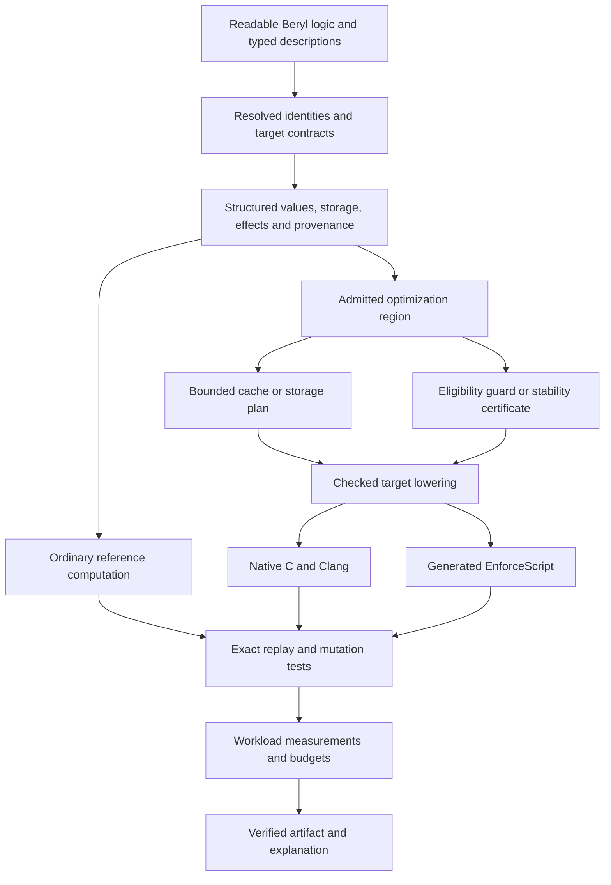

# Beryl performance research: doing less work, with evidence

**Research date:** 7 September 2026  
**Audience:** the project owner, Claude, ChatGPT, and future implementers  
**Status:** research and experiment specifications; no optimizations implemented by this report  
**Scope:** Beryl native execution, generated EnforceScript, and the actual SPARKOS MESH workloads

**Reading route:** sections 1–3 establish the recommendation and rules; sections 4–17 specify fourteen hypotheses; sections 19–21 define measurements, adversarial tests, and implementation packets. Section 24 explains the technical terms.

## 1. The strongest direction

Beryl's best opportunity is to make ordinary, readable programs perform less repeated work automatically, while preserving the behavior their authors can observe. That requires the compiler to understand more than individual arithmetic expressions: which object changed, which fields matter, which results are still valid, which storage can be reused, and which engine operations are expensive.

The central hypothesis is:

> Generate the ordinary computation, a bounded representation of its reusable state, and a cheap check that determines whether previous work may be reused safely.

Sometimes the reason is simple: a store changed. Sometimes it is stronger: the store changed, but no deadline can yet have expired. Sometimes the best optimization is much more direct: stop repeatedly walking a map to retrieve its next element, or construct geometry in the arrays the engine will actually consume.

This research identifies concrete opportunities in the current files and develops a longer-term compiler architecture around them. It does **not** establish a speedup over Rust, an FPS increase, or a universal performance advantage. No performance benchmarks or engine sessions were run during this research. The numbers below that describe loops, allocation sites, or emitted elements are source-derived counts, not timings.

Three independent research lanes examined Enfusion workloads, native compilation, and incremental semantics. Their findings were reconciled with the existing blueprint and implementation gates. Consequential API and research claims were checked against primary sources. Several attractive proposals were narrowed because of ordering, mutable aliases, floating-point behavior, or resource-lifetime problems.

### The first experiments I would fund

| Priority | Experiment | Why it deserves attention | What remains unknown |
|---|---|---|---|
| 1 | Verified map cursor traversal | Current code repeatedly uses indexed map access documented as O(n) | Cursor cost, exact enumeration order, and invalidation behavior |
| 2 | Query workspace and intermediate elimination | The current single-provider marker path contains five explicit temporary container allocations | Actual allocation cost, reference retention, and complete-query benefit |
| 3 | Direct terrain chunk construction | Relief geometry is first assembled into band buffers and then copied into final chunks | Engine lifetime details and measured interaction latency |
| 4 | Sensor scan-generation stamps | Repeated linear membership searches can be replaced without changing scan frequency | Whether bookkeeping matters beside engine tracing |
| 5 | Conservative no-expiry certificate | Some sweeps can be proved to remove nothing without a heap or changed schedule | Whether every relevant mutation can be observed cheaply |

The most ambitious research direction is **result-stability certificates**: proving that a particular output remains identical even after relevant inputs change. The first certificate should be the small, auditable expiry case. Complex geometric certificates come later.

For native performance, the first investment should be optimization evidence and storage correctness. Replacing the backend or adding an elaborate optimizer before measuring the generated machine code would make it difficult to know whether anything improved.

## 2. What exists, what is proposed, and what must remain separate

### Current implementation baseline

The [implementation state](C:/Users/moham/Desktop/beryl/docs/SPARKOS_IMPLEMENTATION_STATE.md) records a passed M3 gate in an isolated MESH candidate. The full Beryl PID ran through the existing suite and actual handover/reset checks. The live MESH project has not been migrated. M4–M8 and independent multiplayer acceptance remain incomplete.

Relevant recorded evidence includes:

| Evidence | Recorded result | Interpretation |
|---|---|---|
| [Foundation results](C:/Users/moham/Desktop/beryl/build/foundation-d3l4o2d4/results.json) | 310 cases, 1,831 checks, 15 native O0/O2 regression programs | A correctness baseline for the recorded compiler and inputs |
| [PID results](C:/Users/moham/Desktop/beryl/build/pid-i8zji6j2/result.json) | 8 tests, 2,206 assertions, 2,195 operations; 65,850 engine comparisons, recorded maximum difference zero | Strong evidence for the admitted PID corpus, not universal numerical equivalence |
| [MESH candidate results](C:/Users/moham/Desktop/beryl/build/mesh-pid-ej8h72g_/result.json) | Compilation, nine suites, 18 host checks, actual takeover/release and three-controller reset | Isolated host-side integration evidence, not a dedicated-server/two-client result |

The recorded installed compiler SHA-256 is `c7a7b3b10221b74f9078aeded70206f34f2c76d9b4242f8d0bea6455dac31f85`. These results are existing evidence, not tests rerun for this report. Research input fingerprints were captured separately; a source snapshot alone is not test evidence.

The current native driver emits a combined program C file and a separate runtime C file. It invokes Clang with release `-O2`, `-ffp-contract=off`, and `-fno-fast-math`. The inspected argument construction does not expose PGO, LTO, or optimization remarks. This follows [the native build driver](C:/Users/moham/Desktop/beryl/src/driver/build.c:87).

The compiler has typed AST analysis and C/EnforceScript emitters. The bounded reference interpreter is useful for admitted scalar, record, and fixed-array logic; it does not provide an independent oracle for arbitrary owning containers, engine objects, or the whole proposed optimizer. M5's structured IR and complete owned-storage semantics remain prerequisites.

### Three comparisons, three answers

| Comparison | What it can establish |
|---|---|
| Generated EnforceScript versus current handwritten EnforceScript | Whether Beryl improves the actual script workload |
| Native Beryl versus native Rust | Whether an equivalent native program improves under matched conditions |
| Beryl authoring versus the current mod-authoring workflow | Whether an assistant reaches a verified change with fewer repair rounds and less effort |

Native Beryl runs as a native executable after C compilation. Enfusion-target Beryl becomes EnforceScript and executes through the game's supported scripting environment. Native SIMD or Clang improvements do not automatically accelerate that script environment, terrain sampling, physics, rendering, or networking.

Rust must receive the same algorithmic opportunities. It supports configurable overflow checks, panic behavior, optimization and LTO settings; `unsafe` does not turn off the borrow checker. Neither release defaults nor an `unsafe` caricature is a valid comparison baseline. See [Cargo profiles](https://doc.rust-lang.org/cargo/reference/profiles.html) and [Unsafe Rust](https://doc.rust-lang.org/book/ch20-01-unsafe-rust.html).

The existing [benchmark document](C:/Users/moham/Desktop/beryl/docs/BENCHMARKS.md) explicitly labels its scorecard historical and unverified. Its old timings and overhead percentages must not be reused. The old harness includes an overflowing checked workload and ignored execution failures; a replacement experiment protocol is required.

### Relationship to the existing blueprint

The [optimization blueprint](C:/Users/moham/Desktop/beryl/docs/BERYL_OPTIMIZATION_AND_ENFUSION_BLUEPRINT.md) already proposes effects, versioned dependencies, incremental queries, checked blocks, private layouts, destination construction, demand selection, bounded search, and resource profiles. This report refines those proposals rather than presenting them as newly invented research.

| Existing direction | Newly established or sharpened here |
|---|---|
| Container and loop optimization | A specific documented map-cost mismatch in an actual per-frame query path |
| Query fusion | A duplicate-resolution counterexample that makes ordinary filter pushdown incorrect |
| Destination construction | Exact terrain buffer counts and a segmented builder preserving band/chunk ordering |
| Incremental maintenance | Accepted local event epochs, identity replacement, bounded logs, and field-complete invalidation |
| Temporal optimization | A conservative lower-bound certificate before introducing an expiry heap |
| Demand-driven computation | Coherent cache eviction and the weak-dependency reclamation correctness trap |
| Version caching | Sufficient-condition certificates that can survive relevant input changes |
| Checked blocks | A tightly bounded experiment comparing whole-block replay with successful-prefix publication |
| Native optimization | A measurement-first path exposing Clang's decisions and comparing matched Rust implementations |

The potential distinction is the integration: a model-neutral authoring language that makes these techniques available through readable programs, checked contracts, target-aware lowering, and explanations. This report does not claim that incremental computation, certificates, reuse, or schedule search originated with Beryl.

## 3. One semantic contract for every experiment

An optimization must name what it preserves before it names what it accelerates.

For a stateful program, compare an ordered trace containing relevant returned values, shared identities, writes, callbacks, commands, failures, and the state required for future operations. Equal final numbers are insufficient when the write order or first failure differs.

Every experiment must declare:

1. **Input domain:** widths, finite/nonfinite policy, collection bounds, valid object states, and permitted callbacks.
2. **Observations:** values, sequence order, reference identity, state transitions, diagnostics, and engine effects that are part of the contract.
3. **Capture boundary:** where inputs become coherent and whether rereading the engine may observe different state.
4. **Resource policy:** which allocation/lifetime outcomes are part of equivalence and the exact workspace bound.
5. **Fallback boundary:** what private computation can be discarded, and whether any external effect has already occurred.

Use the blueprint's distinction between `resource_adequate_exact` and `resource_observable_exact`. Under the former, explicitly admit a bounded domain with sufficient resources for the compared executions. Under the latter, allocation failure and its observable consequences must also be preserved. Removing or adding allocations is not automatically exact over every out-of-memory execution.

An optional cache cannot allocate through an aborting allocator and then claim to fall back if allocation fails. Beryl's current `beryl_grow` failure path is not a general recoverable optional-cache API. A bounded preallocated cache or a future checked reservation mechanism needs its own verified contract.

Likewise, sharing references in a cache can prolong object lifetime. Preserving the numeric contents of an entity does not establish that retaining the entity is legal. Engine bindings must describe retention, validity, deletion, and callback behavior.

For floating-point exactness, preserve the actual expression grouping and admitted target behavior. A real-number identity is not necessarily an identity of rounded binary32 operations. The PID's documented cross-target tolerance is specific to that validation; it is not permission to widen tolerances for arbitrary optimization failures.

The existing language's immediate `defer` behavior remains unchanged. Compiler-generated ownership cleanup must be implemented independently; this research does not introduce scope-exit semantics through an optimization.

## 4. H01 — Make engine container costs visible to the compiler

**Hypothesis:** target-aware traversal can remove repeated searches through the same map, and Beryl can prevent this pattern from recurring in AI-authored code.

### Local evidence

`SPK_MeshStore.GetAll` enumerates the store with indexed `GetElement` calls. `SPK_EntityQuery.QueryAll` repeats this pattern on its merged map. `Sweep` traverses backwards and obtains indexed elements and keys. See [the store](<C:/Users/moham/Documents/My Games/ArmaReforgerWorkbench/addons/SparkOS_Mesh/scripts/Game/SparkOSMesh/Core/SPK_MeshStore.c:63>) and [the query](<C:/Users/moham/Documents/My Games/ArmaReforgerWorkbench/addons/SparkOS_Mesh/scripts/Game/SparkOSMesh/Query/SPK_EntityQuery.c:67>).

Bohemia documents indexed map element/key retrieval as O(n). Calling such an operation for every entry presents a possible quadratic traversal pattern. Both online and installed documentation expose map iterators, but do not establish their complexity, ordering equivalence, or mutation invalidation rules. Consequently, a linear cursor replacement is a hypothesis to verify. See [the official map API](https://community.bistudio.com/wikidata/external-data/arma-reforger/EnfusionScriptAPIPublic/interfacemap.html).

Marker updates reach this query path every focused-tablet frame. Expiry sweeps run at a separately configured cadence, defaulting to 1,000 ms. These are different workloads; measure both.

### Proposed binding information

Extend a future reviewed binding record with separate facts:

```text
signature and engine version
documented complexity / empirically measured scaling
enumeration and replacement behavior
mutation invalidation
reference retention
reentrancy and effects
probe artifact and verification status
```

Cost facts support diagnostics and plan selection. They do not grant semantic permission. An unknown order contract remains unknown even if a microbenchmark shows a faster cursor.

### First experiment

Compile a minimal installed-engine iterator fixture. Compare complete ordered key/reference sequences against indexed traversal after insertion, replacement, removal, and reinsertion. Include empty maps, one entry, repeated keys, and mutation attempts in a separate negative fixture.

Measure N = 16, 64, 256, 1,024, and 4,096 with identical observable checksums and retained live inputs. Fit scaling descriptively; do not infer a complexity class from one small timing. Then measure the complete marker query with the same objects and viewport.

Start with read-only enumeration. For sweep, a possible experiment collects entries first and removes afterwards in the reference order. That is not automatically equivalent: the reference removes during backwards indexed traversal, so mutation-induced order changes and any observable lifetime effects must be tested. Do not mutate an active iterator without a verified contract.

### Cost model and rejection conditions

```text
indexed scan = sum over entries of indexed_lookup_cost(N, index)
cursor scan  = cursor_setup + sum of verified cursor_step_cost
```

These are analytical expressions, not measured coefficients. Reject the replacement if order differs, cursor costs remain high, mutation behavior cannot be specified, or realistic stores are too small for a meaningful benefit. A whole-frame improvement is limited by how much frame work this path actually occupies.

**Readiness:** suitable for an isolated engine probe during M4. General compiler lowering requires a reviewed binding and appropriate container support.

## 5. H02 — Fuse the query only after preserving its winner rules

**Hypothesis:** a bounded invocation-owned query workspace can reduce temporary allocation and copying while preserving winner identity, enumeration, and downstream selection.

### Current pipeline and source-derived cost

```text
Marker.Update
  -> QueryInBounds
     -> QueryAll
        -> StoreProvider.Collect
           -> Store.GetAll
```

For the currently registered single store provider, the successful path contains five explicit temporary container allocations: `visible`, `all`, the merged map, the provider's collected array, and the store provider's additional array. This counts allocation sites before growth and widget work; it does not establish how expensive they are. See [query construction](<C:/Users/moham/Documents/My Games/ArmaReforgerWorkbench/addons/SparkOS_Mesh/scripts/Game/SparkOSMesh/Query/SPK_EntityQuery.c:41>), [provider collection](<C:/Users/moham/Documents/My Games/ArmaReforgerWorkbench/addons/SparkOS_Mesh/scripts/Game/SparkOSMesh/Query/SPK_Providers.c:23>), and [marker update](<C:/Users/moham/Documents/My Games/ArmaReforgerWorkbench/addons/SparkOS_Mesh/scripts/Game/SparkOSMesh/UI/SPK_MarkerLayer.c:143>).

The current array API supports reserving capacity and clearing elements while retaining backing memory. That makes workspace reuse plausible, but elements are destroyed/released on clear, so the reference-lifetime contract still matters. See [the official array API](https://community.bistudio.com/wikidata/external-data/arma-reforger/EnfusionScriptAPIPublic/interfacearray-1-g.html).

### The counterexample that governs the plan

Consider two records for the same ID:

| Provider | Timestamp | Viewport membership |
|---|---:|---|
| First | 10 | Inside |
| Second | 11 | Outside |

The reference merges first, selects timestamp 11, then filters it out. If filtering is pushed into providers, timestamp 11 disappears before merging and timestamp 10 can incorrectly reappear on the map.

Equal timestamps introduce another constraint: the current `<=` rejection preserves the first encountered record. That actual behavior governs optimization even if an adjacent comment suggests provider-order independence.

The first 128 admitted marker slots are also observable. The cap counts entries that pass eligibility, projection, and slot/root acquisition. Symbol-rendering failure does not prevent the subsequent counter increment: `ApplySymbol` returns no success flag. Stopping provider collection after 128 raw candidates, taking the first 128 bounds matches, or skipping failed symbols to admit additional later entries would be wrong.

### Proposed stages

1. Remove the store provider's redundant intermediate where the caller's collection contract allows it.
2. Reuse explicitly owned workspace without sharing it across nested invocations.
3. Resolve all duplicate winners with the current strict-newer/equal-first rule.
4. Preserve the reference map's output order. Do not silently substitute sorted or insertion order.
5. Consume that ordered winner view through the existing bounds, draw eligibility, projection, and cap decisions.
6. Only later maintain winner state incrementally, with all candidate providers represented sufficiently to recover the next winner after deletion.

A one-provider specialization could avoid a merge table only if registration, duplicate IDs, and source ordering satisfy a proved contract. The presence of one provider in today's production file is not a permanent language guarantee.

### Split dependencies instead of skipping all marker work

Winner identity, position, symbol configuration, viewport, selection, and time are different dependency domains. `FreshnessOpacity` uses the current time even when no entity is published. A store-version-only cache must not freeze fading. See [freshness calculation](<C:/Users/moham/Documents/My Games/ArmaReforgerWorkbench/addons/SparkOS_Mesh/scripts/Game/SparkOSMesh/UI/SPK_MarkerLayer.c:115>).

Similarly, caching a widget value does not by itself justify suppressing its setter: a binding must establish whether equal-value setter calls have observable callbacks or other effects. First optimize pure derivation and preserve the existing application sequence.

### Experiment and rejection conditions

Replay equal timestamps, newer-outside/older-inside duplicates, provider changes, shared object mutation, missing location, viewport edges, zoom thresholds, projection failures, more than 128 candidates, widget acquisition failure, symbol-rendering failure, and passing time with no publications.

Compare the ordered sequence of entity references and the resulting ordered UI actions. Measure container creation, growth, reference copying, complete query time, and whole update time separately.

Reject a general rewrite if reference lifetime, registration effects, enumeration, or reentrancy cannot be preserved. Reject caching if capture and maintenance cost exceeds saved derivation. Reusable capacity must have a retention ceiling; one huge scene must not permanently inflate every UI workspace.

**Readiness:** isolated adapter experiments can precede general automation. Full Beryl admission depends on M5 storage/effects and M6 container/reference contracts.

## 6. H03 — Construct terrain relief directly in final chunks

**Hypothesis:** a segmented destination builder can eliminate intermediate geometry work while producing the same ordered command stream.

### What the implementation already does

The current terrain map caches height samples and chunks relief. Those optimizations already exist. A valid `Render` conditionally resamples, then creates a fresh command array and rebuilds relief, contours, grid, and ownship. The inspected call sites are event-driven; this report does not assume terrain rebuilding happens every frame. See [terrain rendering](<C:/Users/moham/Documents/My Games/ArmaReforgerWorkbench/addons/SparkOS_Mesh/scripts/Game/SparkOSMesh/UI/SPK_TerrainMap.c:300>).

With GRID = 80, resampling makes 6,400 height queries. Relief visits 79 × 79 = 6,241 cells, emitting two triangles per cell: 12,482 triangles. The implementation first inserts eight floats and six integer indices per quad into intermediate band arrays, then `EmitChunked` copies the vertex values and reconstructs final indices. The intermediate index values are not read there; their count determines the number of quads. See [relief construction](<C:/Users/moham/Documents/My Games/ArmaReforgerWorkbench/addons/SparkOS_Mesh/scripts/Game/SparkOSMesh/UI/SPK_TerrainMap.c:336>) and [chunk emission](<C:/Users/moham/Documents/My Games/ArmaReforgerWorkbench/addons/SparkOS_Mesh/scripts/Game/SparkOSMesh/UI/SPK_TerrainMap.c:425>).

That exposes 49,928 intermediate float insertions and 37,446 intermediate integer insertions per complete relief rebuild, plus subsequent vertex-copy reads. These are source-derived element-operation counts. They are not physical allocation bytes or runtime measurements.

### Proposed builder

Maintain one current final chunk per band. Traverse cells in the original row-major order, calculate the same height classification and coordinates with the same grouping, and append directly to that band's current chunk. Close it at the existing 240-quad limit.

Retain completed chunks privately by band, then append commands in the original band order. Within a band, preserve quad and triangle order. Preserve relief → contours → grid → ownship layering, colors, winding, and command-count behavior.

This matters because a tempting single global append stream would interleave bands differently. A two-pass count-and-fill alternative should also be measured: it may reserve exact storage but repeats classification work. Neither strategy is automatically best.

### Engine retention boundary

Canvas documentation says the caller must retain the command array because the widget keeps a pointer. It also describes batching constraints involving adjacent command type and texture. A reusable buffer must therefore remain valid for its consumer, and arbitrary command reordering is not legal merely because it batches better. See [CanvasWidget.SetDrawCommands](https://community.bistudio.com/wikidata/external-data/arma-reforger/EnfusionScriptAPIPublic/interfaceCanvasWidget.html).

Construct the replacement privately. Establish the installed engine's handoff and retention rules before reclaiming the old array or mutating retained commands. Merely calling a setter does not prove that all previous consumer reads have ended.

The current diagnostic tessellation call and logs are observable work. Gating them is a separate explicitly reviewed behavior change. An exact geometry experiment should initially retain them, then measure their contribution separately.

### Test and rejection conditions

Compare command types, ordered vertex bits, indices, colors, counts, and layer order. Exercise water-only, sparse bands, chunk boundaries, resize, zoom, pan, detachment, reattachment, and failed/incomplete rebuilds. Use visual inspection at the current ultrawide resolution and 1920×1080 as a separate gate.

Measure height sampling, relief generation, other command generation, handoff, and rendering independently. The proposed builder does not remove engine height calls. Reject it if retained chunk overhead or allocation patterns erase the savings, or if exact output/lifetime comparison fails.

**Readiness:** a bounded standalone comparison is plausible before a generic destination optimizer. Generalization belongs to M5/M8.

## 7. H04 — Use scan generations for sensor membership bookkeeping

**Hypothesis:** sensor bookkeeping can do less searching while preserving every scan and every dwell update.

The sensor already tests range, field of view, then line of sight. It separates its default 0.25-second scan interval from fixed-tick gimbal/laser work. The proposal is not to invent cheap-first filtering that already exists or to reduce sensor frequency.

The relevant remaining pattern is repeated membership search. `AccumulateDwell` searches remembered contacts; `DecayUnseen` loops through remembered contacts and searches `seenThisPass` for each one. See [sensor evaluation and dwell](<C:/Users/moham/Documents/My Games/ArmaReforgerWorkbench/addons/SparkOS_Mesh/scripts/Game/SparkOSMesh/Sensors/SPK_SensorComponent.c:435>).

### First transformation

Add a last-seen scan generation associated with each remembered contact. A visible contact receives the current generation where the reference currently marks it seen. Decay checks whether that generation matches instead of scanning the current pass's seen list.

Keep the existing contact/dwell arrays initially. If an entry is removed by moving the last element into its slot, move the corresponding generation too. Ordinary Enfusion array removal has this swap-with-last behavior; it differs from ordered removal. See [array removal semantics](https://community.bistudio.com/wikidata/external-data/arma-reforger/EnfusionScriptAPIPublic/interfacearray-1-g.html).

The reference records visibility and accumulates dwell **before** rejecting a `NONE` classification. Stamping only contacts that are published changes future detection progression. Preserve duplicate evaluations too: if the source can accumulate dwell more than once for a target in a scan, stamping must not silently deduplicate those updates.

On generation exhaustion, reset the metadata coherently before reuse. Preserve weak engine-reference validity; an index must not keep deleted entities alive. A later object-key lookup can target `AccumulateDwell`, but it needs a verified identity/lifetime contract and should be a separate experiment.

### Model and experiment

With D remembered contacts and V visible records, the decay membership portion currently performs repeated linear searches, with an O(D × V) worst-case comparison pattern. Stamps can reduce that portion to O(D) comparisons plus visibility writes. The remaining contact lookup and engine scans still cost work.

Vary sensor count, group count, remembered contacts, and visible contacts independently. Compare ordered publications, all dwell state, deletion, reinsertion, intermittent visibility, repeated targets, and generation reset. Measure physics traces separately.

Reject the change if bookkeeping is immaterial to complete scan cost or metadata management/lifetime handling outweighs it. A central leader catalog is a later hypothesis requiring spawn, leader, faction, and observation-epoch contracts. Staggering scans or reducing their frequency changes observation timing and requires a separate product decision.

**Readiness:** application-specific prototype after baseline profiling; general language treatment follows explicit identity and state contracts.

## 8. H05 — Prove that a sweep cannot remove anything

**Hypothesis:** a conservative deadline certificate can skip empty expiry scans at the existing callback times, with less machinery than a heap.

Current expiry semantics are: expiry ≤ 0 means persistent; otherwise an entity expires when `now >= expiry`. Sweep reports removals in its backwards map-traversal order. See [expiry](<C:/Users/moham/Documents/My Games/ArmaReforgerWorkbench/addons/SparkOS_Mesh/scripts/Game/SparkOSMesh/Core/SPK_MeshEntity.c:27>) and [sweep](<C:/Users/moham/Documents/My Games/ArmaReforgerWorkbench/addons/SparkOS_Mesh/scripts/Game/SparkOSMesh/Core/SPK_MeshStore.c:63>).

### Certificate invariant

For admitted finite values, maintain either a verified absence of positive deadlines or a bound B such that:

```text
for every current positive deadline d: B <= d
```

At the existing `Sweep(now)` call, clear the output list as usual. If the certificate is valid and either no positive deadline exists or `now < B`, no entity can be expired. Return zero. Otherwise execute the original sweep, preserving its removal order, and refresh the certificate from the surviving entries.

This uses the stored binary32 deadline, without reconstructing creation-time arithmetic in a different precision.

### Cheap conservative maintenance

An accepted insertion or earlier deadline lowers B. Removing an entity or extending a deadline may leave B unnecessarily early; that merely causes an extra reference sweep. A full sweep can establish a fresh bound. Use an explicit empty-deadline state rather than assuming an infinity sentinel is supported everywhere.

The largest obstacle is current shared mutability. `Get` returns an entity reference and its expiry field is public. A write through that reference can shorten a deadline without `Publish`. A publication counter alone cannot establish the invariant. Either every relevant write passes through a verified boundary, or the certificate is invalidated. Scanning all expiry fields to validate it may erase the benefit.

Rejected publications must not update the accepted-state certificate as if they changed the store. Same-key replacement and persistent-to-expiring transitions must be covered. Nonfinite values use an accurately specified reference path. A time rollback must preserve the actual store semantics; previously removed entries do not reappear.

### Why start without a heap

A heap emits deadline order, which differs from the reference's removal sequence. A lazy heap can also retain unbounded obsolete entries when deadlines are extended frequently. The conservative bound avoids both problems: whenever anything may expire, the original scan remains authoritative.

Only if this leaves a measured expensive workload should an indexed heap with one live entry per entity generation be considered. Sparse removal still requires preservation of the reference enumeration/removal contract, including costs of any order representation.

### Experiment and rejection conditions

Replay empty/all-persistent stores, far-future deadlines, repeated extension, deadline shortening, expiry bursts, exact-boundary and neighboring f32 times, removal/reinsertion, rejected stale publications, world reset, and an alias-write mutant.

Compare full removal sequences at identical sweep times. Measure accepted-update overhead plus sweep cost over the whole trace. Reject if most sweeps immediately invalidate the certificate, mutation capture requires equivalent scanning, or metadata adds more work than it saves.

**Readiness:** the algebra is small; automatic admission is blocked by incomplete mutation coverage. Resolve that through M5/M6 rather than assuming it away.

## 9. H06 — Compile a bounded change program beside the full program

**Hypothesis:** for selected pure queries, Beryl can generate incremental maintenance automatically, with static typed cache records rather than a dynamic object graph for every expression.

Incremental-calculus research provides a foundation for deriving change programs. Cache-transfer-style work adds explicit retained intermediate values, because a derivative alone may still recompute useful work. This is established research; adapting it to Beryl's ordered values, engine references, and failure semantics is the experiment. See [Cache-Transfer Style, ESOP 2019](https://link.springer.com/chapter/10.1007/978-3-030-17184-1_20).

### Proposed transformation, not current Beryl syntax

```text
initialize(snapshot) -> result, cache
update(cache, accepted_transition) -> replacement_cache, result_delta
evaluate_full(snapshot) -> result
```

The central obligation is:

```text
apply_result_delta(Q(S), DQ(S, delta)) == Q(apply_input_delta(S, delta))
```

Equality includes the selected output's sequence, identities, duplicates, failure behavior, and future state. A SQL-style unordered bag equation is insufficient for an ordered UI result.

### Accepted events, not arbitrary timestamps

A proposed event contains:

```text
cache generation and world identity
accepted local sequence
entity key and entity generation
insert / update / delete
old and new admitted projections
changed-field mask
binding-contract fingerprint
```

First apply the existing source acceptance rules, including strict-newer rejection. Then produce the local transition. Network timestamps remain data; they do not replace the compiler's sequencing and identity discipline.

Same-key replacement with equal projected scalar fields can still change the returned object reference. A cache must update that identity. Deleting a winning provider record requires sufficient retained information to identify the next winner; retaining only the current winner is insufficient.

### Coherent epochs and bounded memory

A query sees one coherent accepted epoch. A partially applied delta sequence must not be combined with freshly read engine fields. Unknown alias writes, reentrant mutation, missing events, changed bindings, or world reload invalidate the affected region.

Start with a total local event order. A distributed partial-order system is unnecessary until an admitted workload requires it. Differential Dataflow is relevant prior art and has an official Rust implementation, which also makes it a fair comparator rather than a feature uniquely available to Beryl. See [Differential Dataflow](https://github.com/TimelyDataflow/differential-dataflow).

Do not retain an unlimited event history. Consume transitions into current state. Bound pending events and auxiliary indexes; if a limit is exceeded, invalidate and rebuild from a coherent snapshot. Advance to a new cache generation before sequence wrap so an ancient version can never appear current again.

### Restrict the initial algebra

Start with keyed filter/projection and bounded counts. Admit joins only with explicit fan-out and memory bounds. For an algebra where the operations are valid, updating both sides of a join requires the cross term:

```text
delta(R join S) = (deltaR join S) + (R join deltaS) + (deltaR join deltaS)
```

Here `R` and `S` are the pre-update collections. A sequential updater using an already-updated side accounts for the cross term differently and must not add it twice. The equation is design notation, not a blanket rule for Beryl's checked integers, ordered output, floating-point sums, or mutable references. Each primitive needs its own exact transition law. Non-associative reductions and arbitrary effectful callbacks remain outside the initial subset.

### Cost model and lower bounds

```text
full trace cost = sum of full evaluations
incremental cost = initialization + capture + event production
                 + maintenance + materialization + fallback + cleanup
```

An O(delta) updater does not make returning a full K-entry array O(delta). Materializing K references still costs work. If all K engine widgets must receive calls, reducing query maintenance may leave those calls unchanged.

Vary total rows, changed fraction, relevant fields, provider count, ordered insertion cost, and related queries. Include update storms and cold starts. Reject if mutation capture itself requires scanning everything, ordering maintenance dominates, auxiliary state exceeds its budget, or realistic traces seldom reuse results.

**Readiness:** M5/M6 foundations first. Prefer one generated static cache over a general reactive runtime.

## 10. H07 — Reuse a result even when its inputs changed

**Hypothesis:** the compiler can synthesize a cheap sufficient condition proving that a selected output remains unchanged across a region of input values.

This goes beyond ordinary version memoization. A changed dependency normally invalidates a version cache. A result-stability certificate asks whether the change can affect the particular observation.

### Formal shape

Given prior output r and witness w:

```text
guard(w, new_inputs) => Q(new_inputs) == r
```

The guard may fail conservatively. Failure means evaluate the ordinary query and refresh the witness. It must never succeed incorrectly. The guard itself must be total and non-observing: its arithmetic, logging, engine effects, or resource handling cannot introduce a failure or other observation absent from the reference. Unsupported or unavailable witness checks select the ordinary path; they do not create a new program failure.

Kinetic data structures are a direct precedent: certificates establish a geometric result while their relationships hold, and their failure triggers repair. Beryl would explore a restricted compiler adaptation, not claim to invent this idea. See [Kinetic Data Structures: Animating Proofs Through Time](https://graphics.stanford.edu/~comba/papers/socg.pdf).

### Candidate families

| Certificate | What it proves | First boundary to handle |
|---|---|---|
| Deadline lower bound | No current entry can expire at this callback | Earlier expiry through any alias |
| Total comparison interval | A boolean/classification remains constant | Exact machine comparison boundaries |
| Winner separation | The current winner still outranks every competitor | Ties, insertions, identity replacement, complete ordering tuple |
| Spatial membership region | A point remains inside/outside the actual query predicate | Observer movement, rounded arithmetic, teleports |
| Existing quantized projection cell | The emitted discrete coordinate remains the same | Verified engine projection and rounding behavior |

The expiry certificate in H05 is the smallest practical example. A winner certificate is useful only if checking competitor bounds is cheaper than finding the winner again. If the result contains both winner and exact score, a stable winner does not justify returning a stale score.

### Finite precision and engine observation

A real-number distance margin is not automatically a valid region for a grouped f32 distance calculation. Every intermediate rounding and admitted exceptional value matters. Begin with total comparisons whose machine behavior is simple; extend to interval enclosures only with a checked arithmetic model.

Do not predict arbitrary future engine motion from the last velocity sample. Teleports, physics impulses, and external setters can invalidate such a model. A verified motion envelope would be an additional binding/product contract.

The current marker path receives integer coordinates from an engine map projection, while the terrain helper also contains floating-point projection calculations. This does not establish the engine's exact projection-cell boundaries. A pixel-cell experiment requires that contract; arbitrary extra quantization would change behavior. See [map projection](<C:/Users/moham/Documents/My Games/ArmaReforgerWorkbench/addons/SparkOS_Mesh/scripts/Game/SparkOSMesh/UI/SPK_MapView2D.c:116>).

Initially, certificates inspect newly captured positions. That may avoid expensive derived processing but does not eliminate the engine position reads themselves. Preserve engine calls with observable effects and the ordering of any resulting actions.

### Cost and kill criteria

Let g be guard cost, c capture cost, p the guard-success fraction, f full evaluation cost, and r average witness refresh cost on failure:

```text
candidate average cost = c + g + (1 - p) * (f + r)
```

Compare against a baseline with its actual capture costs; do not charge capture to only one side. This is an accounting model, not an estimate of p or a predicted speedup.

Use boundary-hovering inputs, moving observers, exact ties, new candidates, reused IDs, invalidation storms, and deliberately unsound witnesses. Reject if the guard is as expensive as the query, succeeds rarely, omits an observed field, or relies on a motion/rounding contract that cannot be established.

**Readiness:** high research value; start with H05 and simple scalar predicates. This is the strongest longer-term hypothesis in the report, with correspondingly strict admission requirements.

## 11. H08 — Maintain only derived state that observers need

**Hypothesis:** a small static demand graph can stop maintaining hidden pure display derivations without stopping mandatory gameplay state.

Distinguish mandatory evolving state, pure derived state, and observation roots. PID integration, authoritative commands, required replication, and expiry removal continue under their existing contracts. Label formatting, classification summaries, and display-only filtered views may be maintained on demand.

Adapton separates observers from incremental computations and repairs dirty computations when demanded. This supplies a useful model, while also making cold execution, retained state, and invalidation costs part of the assessment. See [the Adapton project](https://www.cs.umd.edu/projects/PL/adapton/).

### Proposed bounded design

Begin with compiler-known dependencies among a small set of pure derived functions. Admit deferred derivations only when skipped evaluations are total and have no required failure, cleanup, allocation, or other observations under the selected resource profile. Purity alone is insufficient: a hidden checked calculation could still overflow. Closing a view removes its eligible display roots from demand. Changes mark affected nodes dirty. Reopening refreshes the dependency closure before the required observation occurs.

A dirty value is invalid internal storage, not a stale answer that can be published. Deferring completion until a later frame changes behavior unless the original interface permits that delay. Frequent view reopening may favor eager maintenance.

Shared subexpressions must match declaration identity, arguments, semantic profile, binding versions, and captured epoch. Do not merge two computations merely because their source text looks alike.

### Reclamation is a correctness problem

Nominal Adapton describes a failure mode where weak memo references and weak invalidation backedges can allow a retained computation to be reused after required dependency edges were collected. The lesson is specific: reuse eligibility and invalidation ownership must be reclaimed coherently. See [Incremental Computation with Names, Appendix A](https://arxiv.org/html/1503.07792v6).

Start with whole-region eviction and forbid cross-region dependency sharing in the initial implementation. Evicting a region removes its eligibility for reuse; its next observation evaluates from scratch. If cross-region sharing is introduced later, eviction must invalidate dependent regions transitively and reject references to the evicted generation. Bound nodes, edges, retained values, and engine references. Do not design a cache that saves CPU by keeping deleted world objects alive.

A useful later research question is sharing a memory budget across several caches. The first policy should be deterministic and simple: fixed per-region caps plus explicit eviction. Sophisticated adaptive policies need their own measurement and must not create unbounded metadata or unstable latency.

### Experiment and rejection conditions

Replay open/close/view-switch patterns, updates while hidden, sudden reopen, shared subqueries, branch dependency changes, deletion/reinsertion, eviction, and world reload. Measure full update maintenance plus reopen latency and peak retained memory.

Reject if realistic observers demand nearly everything, invalidation traversals dominate, or cold refresh violates the required response budget. Do not replace a simple eager cache with a general dependency graph unless it earns its cost.

**Readiness:** after static incremental state and effects are verified; later than a single expiry certificate.

## 12. H09 — Plan physical storage across a complete computation

**Hypothesis:** once logical value semantics are correct, Beryl can reuse compatible storage across non-overlapping lifetimes and construct results in their final destinations.

The current C backend represents records and fixed arrays directly, and ordinary argument lowering materializes value temporaries. That is a source-level opportunity, not proof of actual machine copies: Clang may already eliminate them. Lists currently use pointer/length/capacity representation, so complete nested copying, growth checks, moves, and cleanup must be established before optimizing their ownership. See [C type emission](C:/Users/moham/Desktop/beryl/src/back/c_backend.c:185) and [argument lowering](C:/Users/moham/Desktop/beryl/src/back/c_backend.c:641).

### Proposed storage plan

Keep logical value identity separate from physical allocation identity. Record last read, initialization state, size, alignment, escapes, replacement overlap, and cleanup obligations. Two logical values may share storage only if their required lifetimes and observation contracts do not interfere.

Start with fixed-size plain records/arrays in single-function acyclic control flow. A deterministic greedy interference allocator is enough for an initial experiment. Add branches, loops, caller destinations, and owned buffers progressively.

Read-only parameters should borrow admitted values rather than automatically deep-copying them. `sink` should transfer ownership. Destination construction must not expose partially produced values to observers. Self-assignment and overlapping replacement must preserve source reads until they are complete.

Scratch is per invocation, with a bound covering recursion and nested callbacks. A single global scratch array is unsafe under reentrancy. Large inferred temporaries must not silently become unbounded stack allocations.

### Prior art and counterevidence

MLIR bufferization uses SSA and destination information to select in-place buffers. Bufferization and deallocation are separate tasks. Its ownership-deallocation documentation warns that unsimplified generic deallocation can itself have quadratic alias-check costs. Borrow the separation of concerns, not an assumption that importing machinery is free. See [MLIR Bufferization](https://mlir.llvm.org/docs/Bufferization/) and [Ownership-based Buffer Deallocation](https://mlir.llvm.org/docs/OwnershipBasedBufferDeallocation/).

Perceus demonstrates reuse of compatible dead storage in a reference-counted setting, but also reports cases where sharing weakens reuse and retention increases memory. Beryl should not adopt reference counting merely to obtain a reuse mechanism when static ownership may suffice. See [Perceus, PLDI 2021](https://www.microsoft.com/en-us/research/uploads/prod/2021/06/perceus-pldi21.pdf).

### Experiment and rejection conditions

Compare ordinary Beryl after Clang optimization against a storage-planned path on large fixed-array transformations, branch-dependent temporaries, and later admitted nested owned values. Retain optimized IR/assembly and label diagnostic counters by their instrumentation point and build identity. Semantic copy counts and retained runtime-call counts are different measurements; instrumenting an operation can itself prevent Clang from eliminating it. Corroborate claims about machine work in the optimized timing build with that build's output or appropriate profiling.

Give Rust borrowed slices, caller-provided destinations, and reusable vectors. Include construction, cleanup, peak memory, recursion, and reentrancy.

Reject if Clang already removes the copies, reuse extends memory retention beyond budget, or annotations become harder for an assistant to use than an explicit bounded workspace. Correctness precedes inference sophistication.

**Readiness:** M5 is a hard prerequisite for general owning-storage optimization.

## 13. H10 — Establish loop safety facts once

**Hypothesis:** a loop-wide contract can jointly eliminate repeated bounds, alias, and arithmetic checks while preserving the reference failure path.

A useful contract describes actual storage roots and projections, stable lengths, disjoint ranges, absence of resize/free or conflicting callbacks, and ranges for each arithmetic intermediate. Local variable names and superficial parameter modes do not establish disjoint storage.

Use static proof first. When facts depend on inputs, a non-throwing eligibility guard chooses an optimized path or the ordinary path. A failed optimization guard must not report a source error earlier than the source program would have produced it.

### Example obligation

For `out[i] = a[i] * k + b[i]`, proving the final mathematical result fits i32 is insufficient. Both the multiplication and subsequent addition must fit if the source checks each operation. The guard must also preserve earlier bounds failures, effects, and mutation order.

Discovering ranges through a full input scan has a cost. That scan may be profitable only if its facts serve multiple passes or avoid substantially more work. Observed training inputs do not prove a universal range.

LLVM already generates runtime disjointness checks in some vectorized loops and exposes missed-optimization diagnostics. Beryl must determine what extra information its lowering supplies beyond the backend's existing ability. See [LLVM vectorization documentation](https://llvm.org/docs/Vectorizers.html).

`restrict`, `noalias`, `nsw`, and `nuw` are contracts, not optimistic hints. In LLVM, overflow under `nsw`/`nuw` can produce poison; it is not a checked overflow branch. Emit such facts only when proved for the actual path. See [LLVM Language Reference](https://llvm.org/docs/LangRef.html).

### Experiment and rejection conditions

Use fixed-array transforms across sizes below and above SIMD widths. Include disjoint and overlapping inputs, repeated aliases, resize through callees, boundary arithmetic, empty arrays, and invalid tails. Keep generated C, optimization remarks, and assembly to identify which fact enabled any gain.

Compare against Rust using appropriate slices, exclusive mutable access, iterators, and checked arithmetic. Reject if guard cost dominates, Clang already proves the facts, or a negative case enters the fast path.

**Readiness:** after structured places, effects, ownership and range rules. This does not justify adding `restrict` to the current backend globally.

## 14. H11 — Compare two exact checked-block recovery strategies

**Hypothesis:** for a very narrow loop shape, publishing the successfully computed prefix of a failing block may avoid replay work. It may also be slower and more complex than the existing blueprint's whole-block replay proposal.

Begin with the simpler all-or-replay design from blueprint §13. Only then test this extension.

### Admitted loop

Require stable immutable input ranges, disjoint output, valid active-lane loads, defined non-trapping speculative arithmetic, and one final store per iteration. Exclude callbacks, logs, allocation, user destruction, externally visible intermediate writes, and operations whose speculative evaluation can itself fail outside the controlled flags.

For an initial i32 multiply/add kernel, widened i64 intermediates can represent the required products and sums. This reasoning does not extend automatically to arbitrary i64 multiplication or division. Inactive lanes must not load invalid addresses.

### Proposed block behavior

1. Compute private candidate values and per-operation failure flags.
2. Locate the earliest failing iteration, then the first failing source operation within it.
3. If none fails, publish final stores in the source-observable order.
4. If a failure exists, publish only complete preceding iterations.
5. Execute the failing iteration through the scalar reference path to produce the original diagnostic and failure behavior.

Even successful SIMD stores require an admitted observation contract; concurrent or reentrant observation of partial stores is outside this initial loop shape. Failure in a later operation of an iteration cannot permit that iteration's final store.

LLVM provides overflow intrinsics with arithmetic results and per-lane flags for vector forms. Their existence does not establish an efficient lowering through Beryl's current C backend or on the installed CPU. See [LLVM overflow intrinsics](https://llvm.org/docs/LangRef.html#arithmetic-with-overflow-intrinsics).

### Experiment and rejection conditions

Compare scalar checking, whole-block replay, and successful-prefix publication. Place failures at every source operation in every lane; include simultaneous failures and all tail sizes. Compare exact output prefix and first diagnostic location.

Measure success throughput separately from terminating failure latency. A failing execution cannot be modeled as if it continues processing all later blocks. Reject the extension if mask handling or prefix stores regress success, scalar replay is already cheap, or the added correctness burden has little measured value.

**Readiness:** later native-only research. Enfusion SIMD lowering is not established by this proposal.

## 15. H12 — Select a small number of private layouts and schedules

**Hypothesis:** validated configuration can select a small set of specialized representations and schedules, amortizing setup over repeated work.

Candidate native workloads include fixed channel counts, hot numeric fields separated from cold labels, and a private array-of-structures versus small array-of-structures-of-arrays tile. Start with two variants plus a generic fallback. Do not begin with unrestricted combinatorial schedule search.

The representation is private: do not rearrange engine entities, exported ABI, serialization, replication formats, or observable enumeration. Configuration that can change through a setter must invalidate the specialized assumptions before use. A profile distribution is a profitability hint, not proof of an input restriction.

For the PID, unchanged observations never justify skipping state evolution. A zero gain does not by itself make associated state irrelevant; later setters, resets, or state inspection can expose it. Preserve all state obligations and floating-point rules before specializing any branch.

Halide provides prior art for separating algorithm from schedule and exploring locality/recomputation tradeoffs. Its image-processing results do not predict Beryl or Enfusion performance. See [Halide, PLDI 2013](https://people.csail.mit.edu/jrk/halide-pldi13.pdf).

### Lifetime cost model

```text
specialized lifetime cost = setup + layout conversion
                          + repeated kernel execution
                          + maintenance + teardown
```

Conversion is worthwhile only when the saved repeated execution exceeds all additional lifecycle costs. Include configuration churn and peak memory while old and new representations coexist.

### Experiment and rejection conditions

Start with one pure fixed-configuration native kernel. Then use an admitted record-array workload with sequential and random access. Hold out configurations and sizes not used to choose the plan. Measure code size, compilation time, conversion cost, cache behavior where tools support it, and lifetime runtime.

Reject if variants proliferate, random access reverses the benefit, conversion fails to amortize, or ordinary Clang optimization produces equivalent code. No JIT or model API is needed for two precompiled verified variants.

**Readiness:** after correct private representation boundaries and measured workloads.

## 16. H13 — Produce optimization evidence before building a large optimizer

**Hypothesis:** many early native gains can come from fixing a small number of lowering barriers revealed by the existing compiler, rather than replacing it.

A future research mode should retain exact compiler/runtime/CPU/flags identity, generated C, assembly, optimization remarks, and separate diagnostic-build counters for allocations, copies, and checks. Counter records must identify instrumentation location and distinguish source-semantic operations from retained runtime work; they do not automatically describe the uninstrumented timing build. Map each finding back to Beryl source. This is a proposed capability, not an existing command promised by this report.

Compare the current O2 baseline against individually controlled O3, PGO, and optional LTO experiments while retaining the same arithmetic contract. The installed Clang version and rolling online documentation may differ; verify every chosen flag and profile tool locally.

Clang documents profile-guided optimization and the need for representative training. Rust uses LLVM PGO as well; it must receive the same opportunity. See [Clang PGO](https://clang.llvm.org/docs/UsersManual.html#profile-guided-optimization) and [Rust PGO](https://doc.rust-lang.org/rustc/profile-guided-optimization.html).

ThinLTO's cross-module work may offer limited additional benefit while most generated Beryl code is already in one C translation unit, although the separate runtime is still a boundary worth measuring. See [ThinLTO documentation](https://clang.llvm.org/docs/ThinLTO.html).

Train on one workload set, select variants on a validation set, and make final claims on untouched held-out inputs. Include rare branches and cold execution. Reject PGO gains confined to training data, incompatible profile use, silent semantic flag changes, or excessive build overhead.

For the assistant, the useful output is an explanation: why a copy remains, why a loop cannot be vectorized, which alias fact is missing, and what experiment could test the hypothesis. Source syntax alone cannot answer these questions reliably.

**Readiness:** evidence collection is an early native research tool; automatic plan selection is later M8 work.

## 17. H14 — Let search propose; let small checkers decide

**Hypothesis:** bounded offline optimization search can discover useful local plans while independent checking controls legality and reproducible measurements control selection.

The compiler should retain an ordinary reference path and a machine-readable record for every admitted transform. A proposed record contains:

```text
source and IR fingerprints
target and binding fingerprints
semantic/resource profile and admitted input domain
observed output schema and ordered effects
alias/storage assumptions
state invariant
guard implication or transition law
fallback identity
checker result and coverage bounds
memory/code-size/compile-time limits
experiment evidence and held-out result
```

This is a design record, not a current schema. Missing, timed-out, unsupported, and stale checker results are not success.

### Separate three questions

1. **Legality:** does the candidate preserve the selected behavior in the admitted domain?
2. **Profitability:** is it faster for this target and workload after all costs?
3. **Operational usability:** can it be built, debugged, explained, and reproduced within project budgets?

A model may suggest a transformation, a witness, or an experiment offline. It cannot declare its own alias assumptions true or mark an unexecuted test passed. No model inference or model API is required during ordinary compilation or gameplay.

Equality saturation offers a search mechanism for equivalent expressions, but the valid rewrite set must respect effects, failure, widths, and arithmetic grouping. Restrict initial search to small pure total regions with a hard node/time budget. The `egg` project is relevant prior art, not a reason to admit algebraically attractive but semantically invalid rewrites. See [egg, POPL 2021](https://popl21.sigplan.org/details/POPL-2021-research-papers/23/egg-Fast-and-Extensible-Equality-Saturation).

Alive2 demonstrates bounded translation validation for LLVM. Its bounds can miss bugs, and its domain is LLVM IR. It does not establish Beryl source equivalence, EnforceScript behavior, or engine binding validity. Use it, if compatible, as one layer of evidence for relevant native translations. See [Alive2, PLDI 2021](https://web.ist.utl.pt/nuno.lopes/pubs.php?id=alive2-pldi21).

### Whole-maintenance correctness

For a cache or incremental updater, a local expression proof is insufficient. Establish initialization, preservation of the cache invariant by every accepted event, and validity at every observation. Then use mutation tests to attack omitted invalidators, wrong tie rules, generation reuse, truncated logs, and dependency eviction.

Fallback can discard private candidate state and evaluate the reference against the same captured inputs. It cannot replay already applied commands, network requests, or callbacks. Publishing externally visible work before the check has succeeded destroys this simple recovery boundary.

**Readiness:** small independently checked fragments after semantic foundations; offline search only after simpler experiments earn their cost.

## 18. How these pieces could fit together

The proposed architecture should grow from a handful of explicit verified kernels into reusable compiler mechanisms. It should not start as a runtime that tracks everything indiscriminately.



The graph describes a proposed future structure. It does not assert that M5 IR, general cache generation, certificate synthesis, or optimization explanation commands already exist.

### A useful hierarchy of work avoidance

| Level | Question | Example |
|---|---|---|
| Better operation | Are we using an unnecessarily expensive target operation? | Verified cursor instead of repeated indexed map retrieval |
| Better construction | Are we producing data twice? | Direct terrain chunks |
| Better lifetime | Can storage serve non-overlapping values? | Invocation-owned scratch |
| Better dependencies | Which fields actually changed? | Separate symbol, position, viewport and time |
| Better maintenance | Can a change update the result directly? | Incremental keyed filter |
| Better validity test | Did the change leave the observable result identical? | No-expiry certificate |
| Better demand | Is this pure derived result currently required? | Hidden display formatting |
| Better execution | Can a proved kernel use fewer checks or a better layout? | Guarded native loop |

Apply the earliest inexpensive level that solves the workload. A small explicit certificate may be preferable to a general incremental system. A cursor fix may make an elaborate index unnecessary.

### Avoid double-counting wins

Optimizations overlap. Removing intermediate arrays changes the value of allocation reuse. A faster full scan shifts the break-even point for incremental maintenance. Native vectorization may become irrelevant after most iterations are skipped.

Measure each candidate against the **current best verified baseline**, then measure the combined plan. Do not multiply independent headline speedups or add savings for work that another optimization already removed.

## 19. Experiments that can support a performance claim

### First profile the complete workload

For MESH, distinguish query traversal, allocation, symbol derivation, projection, widget updates, terrain sampling, command building, sensor bookkeeping, physics calls, and replication. Record callback counts and input sizes. Bohemia documents script profiling and allocation inspection, but availability, mode names, and overhead must be checked on the installed build. See [Arma Reforger script profiling](https://community.bistudio.com/wiki/Arma_Reforger%3AScript_Profiling).

A long-running function is not necessarily the part whose improvement most reduces the observed latency. Controlled intervention and complete-workload measurement are necessary. Causal profiling research illustrates that distinction; its tools are not claimed to be verified on this Windows/Enfusion setup. See [Coz](https://github.com/plasma-umass/coz).

For a strictly serial decomposition, the analytical upper bound from improving fraction f by factor s is `1 / ((1 - f) + f / s)`. Here f and s are unknown until measured. A game frame is not automatically a serial sum of profiler entries, so use the actual critical path and avoid presenting this formula as an FPS forecast.

### Required experiment record

Record source, compiler, runtime, binding, artifact and dataset fingerprints; engine/OS/CPU versions; exact flags; allocator and safety policy; warm/cold state; input generation seed; measurement scope; and raw outputs. Record failures, timeouts, absent capabilities, and incomplete selections explicitly.

Inputs should include realistic traces and adversarial cases. Relevant dimensions include store size, provider count, changed fraction, scene churn, viewport movement, sensor/contact count, expiry density, cache pressure, and configuration changes. A synthetic large-N win with no relevant MESH workload is a scalability result, not a demonstrated gameplay benefit.

### Measurement protocol

1. Pass semantic comparisons before timing a candidate for a claim.
2. Define the primary metric and practical threshold before examining candidate results. Use the plan's provisional 5% threshold only after baseline noise has been characterized independently; do not tune it to a favorable result.
3. Use at least 30 independent paired measurement blocks. Alternate candidate/baseline order and balance session order. A thousand callbacks in one session are correlated samples, not a thousand independent experiments.
4. Separate cold-start, warm steady-state, burst, failure, and lifecycle measurements. Include initialization, invalidation, capture, maintenance, conversion, reclamation, and cleanup whenever the application pays them.
5. Preserve raw per-block data. Report effect size and uncertainty for individual workloads. Match resampling/statistical units to independent sessions or blocks; do not assume frame samples are independent.
6. Gather enough observations for tail claims. Thirty blocks alone do not establish a stable p99 frame-latency estimate. Report event counts, run lengths, and uncertainty.
7. Treat semantic mismatches or incomplete executions as failed experiments. Do not silently discard slow or failed runs and report the survivors as a success.
8. Use held-out workloads after tuning. Searching many plans and publishing only the best training result overstates confidence.
9. Record peak memory, retained objects, code size, compile time, and diagnostic quality alongside speed. Adopt only a plan that meets its whole budget.

The statistical motivation is supported by work on hierarchical benchmarking and uncertainty, rather than a best-of-three minimum. The repository abstract for [Kalibera and Jones, Rigorous Benchmarking in Reasonable Time](https://kar.kent.ac.uk/33611/) was available during research; full text was not retrieved, so no detailed procedure is attributed to an unread paper.

### Native Rust baseline matrix

| Baseline | Purpose |
|---|---|
| Idiomatic Rust with the same behavior | Compare ordinary authoring outcomes |
| Rust with matched algorithm, layout, scratch and caching | Separate algorithmic advantage from language/backend advantage |
| Tuned Rust with equivalent PGO/CPU capabilities | Test the stronger performance ambition fairly |
| Handwritten C where useful | Diagnose whether Beryl's C lowering leaves avoidable overhead |

Match overflow, bounds, FP grouping/contraction, panic/failure strategy, initialization, allocation, outputs, and workload boundaries. If exact diagnostic formats cannot be matched across languages, report the precise contract used for performance and keep language-specific correctness comparisons separate.

Inspect generated machine code where two native implementations differ. A gain caused by an incremental algorithm is valuable, but the matched Rust incremental algorithm remains the relevant stronger comparison.

### AI usability is measurable too

Use a fixed task set: modify PID behavior, add a component property, bind an event, create a prefab, repair an injected engine error, and run a supported scenario. Keep model/version/context and task difficulty recorded. Measure repair rounds, elapsed time, unsupported-API attempts, required annotations, and manual generated-code edits.

The intended authoring advantage is that assistants write straightforward logic and use explicit compiler evidence. Do not require them to hand-maintain invisible invalidation rules. Whole-mod acceptance still requires zero manual edits to generated output.

## 20. Counterexamples every implementation packet should include

| ID | Deliberate failure case | What must catch it |
|---|---|---|
| C01 | Newer duplicate outside view; older duplicate inside | Winner-before-filter equivalence test |
| C02 | Equal timestamps from two providers | First-encountered tie rule |
| C03 | More than 128 candidates with eligibility, projection or symbol failures | Preserve slot acquisition and counter increment even when symbol rendering fails |
| C04 | Time advances with no publication | Freshness derivation includes time |
| C05 | Expiry shortened through an existing shared alias | Complete invalidation or rejection of cache admission |
| C06 | Same key replaced with a different object and equal scalar fields | Entity-generation/reference identity update |
| C07 | Deadline queue produces correct IDs in a different order | Ordered removal comparison |
| C08 | Event sequence wraps or a bounded log loses entries | New generation or invalidation/rebuild |
| C09 | A cached computation survives missing dependency edges | Coherent eviction/ownership discipline |
| C10 | Nested callback reuses the outer query's scratch | Per-invocation storage and reentrancy test |
| C11 | Canvas still reads an array reclaimed or mutated by a pool | Verified consumer-lifetime contract |
| C12 | Sensor sees a target but classification remains NONE | Stamp and dwell occur before classification rejection |
| C13 | Array removal moves the last contact but not its stamp | Parallel-state alignment test |
| C14 | Final integer expression fits but an intermediate overflows | Per-operation arithmetic proof |
| C15 | SIMD tail speculatively loads beyond valid storage | Active-lane memory validation |
| C16 | Two lanes fail at different source operations | Iteration-major first-failure ordering |
| C17 | Guard fails after an engine command was already sent | Effect boundary rejects replay |
| C18 | Optional cache allocation aborts instead of falling back | Resource-profile/failure test |
| C19 | Config setter leaves a specialized kernel active | Versioned assumption invalidation |
| C20 | Geometry margin is valid in real arithmetic but not f32 | Machine-arithmetic witness checker |
| C21 | Hidden UI skips authoritative state evolution | Mandatory-state versus derived-state separation |
| C22 | Optimizer wins only on its training trace | Held-out workload evaluation |
| C23 | A hidden pure calculation would overflow if evaluated | Deferred-work admission requires totality and no skipped observations |
| C24 | Another cache depends on an evicted region | No initial cross-region sharing; later transitive invalidation |
| C25 | An eligibility guard itself overflows or allocates unsuccessfully | Total, non-observing guard or ordinary fallback |

These are not an assertion that each bug exists in the current implementation. They are adversarial cases derived from the proposed transformations and inspected contracts.

## 21. Implementation order and bounded packets

Keep the [approved SPARKOS plan](C:/Users/moham/Desktop/beryl/docs/SPARKOS_IMPLEMENTATION_PLAN.md) authoritative. This report supplies experiments and refinements; it does not mark any milestone complete or replace correctness work with an optimizer project.

| Packet | Deliverable | Dependency | Exit or stop condition |
|---|---|---|---|
| R0 | Versioned profiling/cost probes and ordered traces | M4 engine identity and reliable jobs | Real executed results; unavailable capabilities remain explicit |
| R1 | Map traversal comparison | R0 and exact iterator syntax | Same ordered references plus useful scaling/complete-query evidence |
| R2 | Query workspace comparison | R1 where relevant; explicit lifetime contract | Same full marker actions; bounded retained memory |
| R3 | Direct terrain chunk comparison | Canvas lifetime probe | Same commands plus independent visual gate and measured benefit |
| R4 | Sensor stamp comparison | Exact array/reference semantics | Same dwell/publications at same scan times |
| R5 | Storage/effect foundation | M5 | Correct copies, moves, cleanup, aliases and growth before optimization |
| R6 | Accepted mutation/capture boundary | M6 compatibility adapter | No untracked admitted writes; preserve shared entity identity |
| R7 | Conservative expiry certificate | R6 | Same removal sequence at every callback; positive whole-trace value |
| R8 | One static incremental query | R5/R6 | Transition invariant, bounded cache and correct fallback |
| R9 | Small result-stability certificate family | R7/R8 plus machine-arithmetic rules | Checked implication and profitable guard |
| R10 | Native evidence, then storage/loop experiments | R5 for transforms; evidence tools can begin earlier | Assembly-supported explanation and matched baselines |
| R11 | Demand graph, layouts and bounded search | Earlier experiments establish need | Memory, latency, build and usability budgets all pass |

R1–R4 can be investigated as isolated source/engine fixtures without claiming Beryl already supports their generic transformations. Promoting them into production or the compiler requires the corresponding semantic and integration gates.

Every packet should include objective, source fingerprints, affected producers and consumers, observable contract, assumptions, implementation sketch, positive/negative cases, raw-result format, migration/rollback behavior, and explicit kill criteria.

Do not automatically rerun the entire engine suite for a research document. When implementation changes relevant code, run the appropriate bounded checks and then milestone integration gates. Preserve original behavior fixtures and never manually patch generated output to make an experiment pass.

### Immediate documentation follow-ups

The [runtime arithmetic comment](C:/Users/moham/Desktop/beryl/runtime/beryl_rt.h:79) still includes an unconditional Rust release-overflow comparison and labels a branch cost measured. That comment deserves a separate evidence-based correction. No source file was changed for this research.

The [M4 packet](C:/Users/moham/Desktop/beryl/docs/M4_IMPLEMENTATION.md) records integer-binding concerns that need reproduction and resolution before related arithmetic optimization. A valid f32 PID result does not establish all integer intrinsics. These remain correctness priorities, not opportunities to benchmark an incorrect fast path.

## 22. Directions to defer or reject for now

| Tempting direction | Reason to defer or classify separately |
|---|---|
| Claim all Beryl will outperform Rust | No measurements establish this; algorithms and workloads dominate comparisons |
| Replace the C backend immediately | Current optimization barriers and machine output have not yet been measured |
| Run native Beryl inside Enfusion through an assumed plugin/JIT | No supported integration contract established by this research |
| Use fast-math as a free speed boost | Can change arithmetic behavior and invalidate existing parity assumptions |
| Skip PID steps when inputs look unchanged | Persistent controller state still evolves |
| Reduce scan/tick frequency under the label exact optimization | Changes observation and action timing |
| Predict engine motion from recent velocity alone | Teleports and untracked physics changes defeat the assumption |
| Shift terrain sample lattices for cache reuse | Can change sampled coordinates and the rendered result |
| Put every expression in a reactive graph | Tracking and retained-memory overhead may exceed saved work |
| Generalize partial-order dataflow immediately | Current local queries can start with a simpler total accepted-event order |
| Add GPU or parallel engine calls speculatively | Threading, synchronization and engine API support are unverified |
| Use weak references as a universal cache solution | Validity edges and cached results can be reclaimed inconsistently |
| Share one mutable workspace globally | Nested callbacks can corrupt in-progress work |
| Let an AI provide unchecked optimization facts | Plausible assumptions are not semantic proofs |

Approximation, altered sensor scheduling, reduced fidelity, and changed visual policies can still be worthwhile product experiments. They need separate behavior requirements and quality measurements so their gains are not confused with exact compiler optimization.

## 23. Source register and research limits

All external sources below were accessed on 7 September 2026. Rolling documentation is identified as such; crawl dates are not publication dates. Primary papers support mechanisms and limitations in their own models. None supplies a Beryl speedup estimate.

| Source | Publication/version information | Role in this report |
|---|---|---|
| [Bohemia map API](https://community.bistudio.com/wikidata/external-data/arma-reforger/EnfusionScriptAPIPublic/interfacemap.html) | Generated official documentation; date not exposed; installed HTML corroborated | Indexed-access complexity and available iterator signatures |
| [Bohemia array API](https://community.bistudio.com/wikidata/external-data/arma-reforger/EnfusionScriptAPIPublic/interfacearray-1-g.html) | Generated official documentation; installed HTML corroborated | Clear/reserve semantics and swap-with-last removal |
| [Bohemia Canvas API](https://community.bistudio.com/wikidata/external-data/arma-reforger/EnfusionScriptAPIPublic/interfaceCanvasWidget.html) | Generated official documentation; date not exposed | Caller retention and batching constraints |
| [Bohemia script profiling](https://community.bistudio.com/wiki/Arma_Reforger%3AScript_Profiling) | Official wiki; substantive indexed content available; direct access limitations occurred in research | Profiling discovery; installed availability remains a probe |
| [Cargo profiles](https://doc.rust-lang.org/cargo/reference/profiles.html) and [Unsafe Rust](https://doc.rust-lang.org/book/ch20-01-unsafe-rust.html) | Rolling Rust documentation | Fair overflow, panic, optimization and language claims |
| [Giarrusso, Régis-Gianas, Schuster: Cache-Transfer Style](https://link.springer.com/chapter/10.1007/978-3-030-17184-1_20) | ESOP 2019, online 6 April 2019 | Static incremental intermediates; publisher abstract inspected |
| [Hammer et al.: Adapton](https://www.cs.umd.edu/projects/PL/adapton/) | PLDI 2014 project and author paper | Demand-driven repair and incremental-computation costs |
| [Hammer et al.: Incremental Computation with Names](https://arxiv.org/html/1503.07792v6) | OOPSLA 2015; extended arXiv revision 2021 | Stable reuse and Appendix A reclamation counterexample |
| [Differential Dataflow](https://github.com/TimelyDataflow/differential-dataflow) | Maintained original Rust project; original paper CIDR 2013 | Incremental dataflow precedent and fair Rust comparator |
| [Basch et al.: Kinetic Data Structures](https://graphics.stanford.edu/~comba/papers/socg.pdf) | SoCG video proceedings, June 1999; two-page overview | Certificate-based maintenance precedent |
| [MLIR Bufferization](https://mlir.llvm.org/docs/Bufferization/) | Rolling LLVM/MLIR documentation | Destination/in-place storage analysis |
| [MLIR Ownership-based Buffer Deallocation](https://mlir.llvm.org/docs/OwnershipBasedBufferDeallocation/) | Rolling LLVM/MLIR documentation | Separate cleanup and generic alias-check cost warning |
| [Reinking et al.: Perceus](https://www.microsoft.com/en-us/research/uploads/prod/2021/06/perceus-pldi21.pdf) | PLDI 2021 | Reuse precedent and retention/sharing counterevidence |
| [LLVM Vectorizers](https://llvm.org/docs/Vectorizers.html) and [Language Reference](https://llvm.org/docs/LangRef.html) | Rolling LLVM documentation; not assumed identical to installed Clang | Runtime guards, optimization diagnostics, poison and overflow contracts |
| [Ragan-Kelley et al.: Halide](https://people.csail.mit.edu/jrk/halide-pldi13.pdf) | PLDI 2013 | Schedule/layout/recomputation precedent |
| [Clang PGO](https://clang.llvm.org/docs/UsersManual.html#profile-guided-optimization), [Rust PGO](https://doc.rust-lang.org/rustc/profile-guided-optimization.html), [ThinLTO](https://clang.llvm.org/docs/ThinLTO.html) | Rolling official compiler documentation | Feedback and cross-module optimization experiments |
| [Willsey et al.: egg](https://popl21.sigplan.org/details/POPL-2021-research-papers/23/egg-Fast-and-Extensible-Equality-Saturation) | POPL 2021 | Bounded equality-saturation search precedent |
| [Lopes et al.: Alive2](https://web.ist.utl.pt/nuno.lopes/pubs.php?id=alive2-pldi21) | PLDI, June 2021 | Bounded LLVM translation validation and its limits |
| [Kalibera and Jones: Rigorous Benchmarking in Reasonable Time](https://kar.kent.ac.uk/33611/) | ISMM 2013; repository abstract/metadata available, full text not retrieved | Measurement uncertainty and hierarchical repetition |
| [Curtsinger and Berger: Coz](https://github.com/plasma-umass/coz) | Original research project; paper SOSP 2015 | Distinguishing time attribution from causal optimization value |

Local source anchors refer to the files inspected for this report. Working trees contain preexisting changes, so future implementation must recheck fingerprints and contracts rather than treating commit IDs or line numbers as immutable evidence.

Open gaps are explicit: no measured MESH bottleneck ranking, no verified iterator complexity/order contract, incomplete mutation interception, unverified consumer retirement timing, incomplete general owned-storage semantics, no independent two-client result, and no current matched Rust performance result. Further generic literature search would not close these gaps; bounded implementation probes and measurements are the next source of evidence.

## 24. Terms used in the hypotheses

| Term | Meaning here |
|---|---|
| Observable contract | Everything the compared program is required to preserve, including relevant order and identity |
| Epoch | A coherent accepted state at which a query is evaluated |
| Delta | An accepted change with enough information to update a derived result correctly |
| Certificate | A sufficient condition proving an output is still valid |
| Fallback | The ordinary verified computation used when optimization eligibility is absent |
| Demand | A current requirement to observe a pure derived result |
| Storage plan | A mapping from logical values to compatible physical storage across their lifetimes |
| Guard | A non-throwing eligibility test; failure selects the ordinary path |
| Held-out workload | Inputs not used to train or select an optimization |
| Kill criterion | A concrete result that makes an experiment unworthy of further complexity |

The practical target is a language in which readable source can earn sophisticated execution through explicit, checked information. The next convincing advance is a small transformation that preserves the actual MESH contract, produces reproducible evidence, and remains easy for either assistant to explain and maintain.
