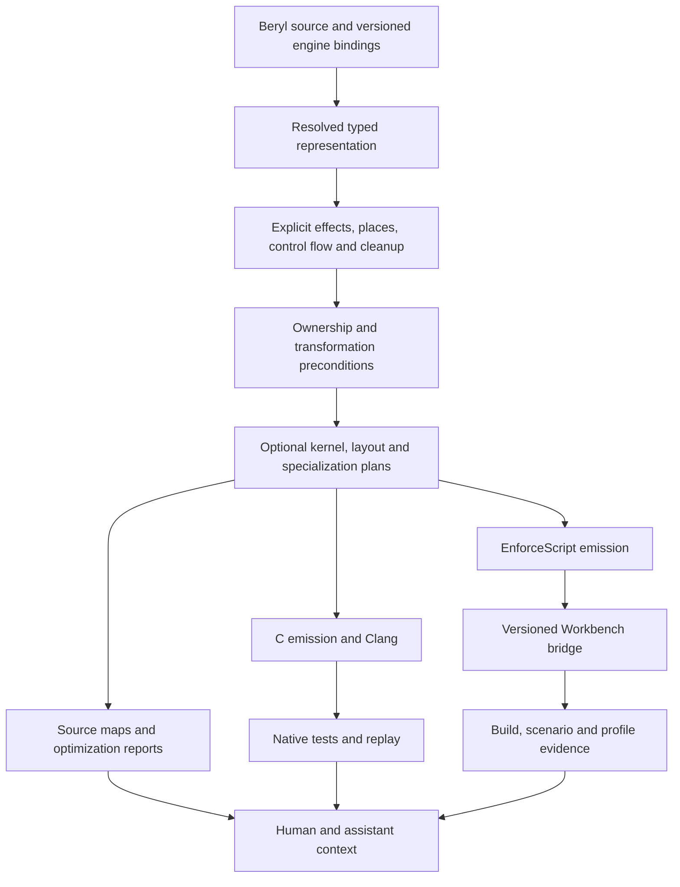

# Beryl: performance and Enfusion research hypotheses

**Status:** exploratory design; no implementation approved or performed by this document.

**Revision 2:** expanded with seven experimental execution models, a semantic IR sketch, worked cost models, counterexamples, and a research execution plan. Start with sections 20–30 for the deeper technical proposal. The additions are designs and analytical examples, not implemented or benchmarked results.

**Prepared:** September 5, 2026, for the Beryl owner, Claude Code, and ChatGPT/Codex.

**Context snapshot:** repository HEAD `0f3dfc2d8c89e4349d0990f94e433586cdd29be4`.

**Companion:** `docs/CODEX_REVIEW_HANDOFF.md`, the earlier correctness review. Recheck its findings against current source; it describes an older snapshot. For example, the native memo map now has initialization and the helper reference has changed. This document is not a second full correctness audit.

## 1. The ambition

Beryl should make efficient, safe simulation programs easier to express, optimize, verify, and maintain than they are in a general-purpose language. Its Enfusion edition should let an AI assistant discover the real installed API, make a precise change, test the logic, validate the generated script, and explain an engine failure without guessing.

The most promising identity is a combination of:

1. Explicit ownership and predictable memory costs.
2. Simulation-aware representations that eliminate unnecessary work.
3. Compiler-checked conditions for aggressive optimization.
4. An inspectable toolchain that explains its decisions in structured data.
5. A version-aware bridge between Beryl source, generated EnforceScript, and Workbench evidence.

This combination could be distinctive. None of the individual techniques should be marketed as unprecedented: region allocation, structure-of-arrays, incremental computation, specialization, and replay all have prior art. The research opportunity is making them cooperate under one coherent language contract.

### What “much faster than Rust” must mean

There are three different comparisons, and every result must name which one it uses:

| Comparison | Valid question | Invalid conclusion |
|---|---|---|
| Native Beryl versus native Rust | Does the same computation run faster with equivalent algorithms, safety, and hardware? | A different algorithm proves universally better code generation |
| Beryl-generated EnforceScript versus handwritten EnforceScript | Does generation reduce script work, allocations, calls, or latency in this engine? | A native Beryl benchmark predicts in-engine speed |
| Development workflow | Does an assistant reach a verified result with fewer failures and less time? | Fewer tool calls prove faster generated programs |

Large runtime improvements are most plausible when Beryl helps eliminate whole categories of work: scanning unchanged entities, materializing temporary collections, allocating per entity, or repeatedly crossing an engine API boundary. A tuned Rust program can use many of the same strategies. Beryl's contribution may be making those strategies automatic, safer, or cheaper to maintain. That is valuable even when optimized native code reaches parity.

**All numerical thresholds below are proposed experiment gates, not forecasts, measurements, or promises.** A failed gate is useful information. Do not manufacture a positive conclusion by weakening the baseline.

## 2. Instructions to a future implementing assistant

- Treat this as a menu of falsifiable hypotheses. Do not implement all proposals as one rewrite.
- All new syntax, commands, filenames under proposed directories, protocol examples, and diagnostic names below are **proposed**, unless explicitly identified as existing.
- First reproduce relevant correctness issues from the companion review. Do not optimize an unsound ownership or arithmetic model.
- Select one narrow experiment, write its semantic contract and baseline, then prototype behind an explicit experimental option.
- Preserve the C backend initially. Introduce structured lowering incrementally; do not jump to a custom native backend without measured evidence that C is the bottleneck.
- Use the installed engine API and a versioned capability probe. Do not invent Workbench methods, flags, native-extension support, or arbitrary live-reload behavior.
- Reuse the existing sibling Workbench plugin where possible. Reading it for this document did not authorize modifying it.
- Preserve user files, unsaved editor work, existing branches, and running sessions. Generated output must be distinguishable from handwritten code.
- For each experiment, return the baseline, exact revision/toolchain, correctness evidence, performance distribution, remaining risks, and a continue/revise/stop decision.

## 3. Foundations that already exist

### Inside Beryl

`src/sema/` contains types, checking, ownership, constant evaluation, and security lints. `src/back/c_backend.c` and `src/back/enforce_*.c` emit from the typed AST. `runtime/beryl_rt.*` contains runtime helpers and vectors. `src/common/source.*` and `diag.*` provide source spans and diagnostics. `scripts/reforger-proof.ps1` already connects generation to an external Workbench build script.

These are useful extension points. They are not evidence that proposed proofs, optimizations, or protocol features already exist. The existing correctness tests and fixture suite need expansion before serving as an optimization oracle.

### In the existing Workbench integration

The sibling directory `C:/Users/moham/Desktop/reforger-workbench-plugin` already contains:

| Existing artifact | Reuse opportunity |
|---|---|
| `scripts/Build-ApiIndex.ps1` | Searchable API index from installed documentation |
| `scripts/Invoke-ReforgerBuild.ps1` | Structured build result and parsed diagnostics |
| `scripts/Invoke-WorkbenchRpc.ps1` | Local NetAPI client with structured replies |
| `scripts/Start-WorkbenchDaemon.ps1` | Starting/reusing a hidden Workbench process |
| `scripts/Test-WorkbenchRpcHealth.ps1` | Distinguishing a responsive session from an unhealthy one |
| `scripts/Get-WorkbenchErrors.ps1` | Parsing engine diagnostics |
| `scripts/Test-ReforgerPrefab.ps1` | Engine-side structural prefab validation |

The inspected API-index metadata records **8,947 classes and 238,118 members**, built August 13, 2026. These are local snapshot counts, not a claim about today's entire engine API. The timestamp alone cannot establish freshness; tool binaries and documentation content must be fingerprinted.

The plugin distinguishes headless build/pack sessions from live RPC sessions and documents profile/resource locks. Its client comments record a tool-version-specific failure of command-line plugin execution, whereas Bohemia documents a command-line plugin entry point. Preserve both pieces of evidence: perform a capability probe for the installed version rather than assuming either behavior universally.

Bohemia documents Workbench plugins and Script Editor validation/debugging facilities. This supports investigating an integration, but does not establish that every proposed bridge operation is exposed through an automatable API. [Workbench plugins](https://community.bistudio.com/wiki/Arma_Reforger%3AWorkbench_Plugin), [Script Editor](https://community.bistudio.com/wiki/Arma_Reforger%3AScript_Editor).

## 4. Hypothesis portfolio

| ID | Hypothesis | Primary benefit | Uncertainty | First experiment |
|---|---|---|---|---|
| H1 | Verified hot kernels | Remove provably redundant checks | Medium/high | Bounded integer array transform |
| H2 | Layout-aware tables | Reduce memory traffic and pointer chasing | Medium | Entity update over selected fields |
| H3 | Phase-owned memory and destination passing | Reduce allocations and copies | Medium/high | Repeated temporary-result pipeline |
| H4 | Incremental simulation queries | Avoid recomputing unchanged derived state | High | Sparse-change targeting/configuration query |
| H5 | Snapshot and command engine boundary | Reduce duplicated engine calls; improve testability | Medium/high | Multi-controller update over shared inputs |
| H6 | Measured specialization with optimization reports | Select profitable implementations predictably | Medium | Fixed-configuration numeric kernel |
| H7 | Model-neutral Workbench bridge | Reduce API guessing and invalid edit/build cycles | Medium | Change → native test → engine validation |
| H8 | Replay laboratory and source-level evidence | Make failures and performance regressions reproducible | Medium/high | Recorded controller input trace |

H1–H3 build a safer and faster execution foundation. H4–H6 seek application-level gains. H7–H8 make those gains accessible and verifiable by both humans and AI assistants.

## 5. H1 — Verified hot kernels

### Hypothesis

If Beryl proves value ranges, collection bounds, and exclusive access for a restricted kernel, it can remove repeated safety checks while retaining checked source semantics. The resulting loop may vectorize or schedule better than a loop whose safety remains opaque to the backend.

LLVM already has loop and straight-line vectorizers and can explain missed vectorization. Beryl should use those facilities before implementing a competing general-purpose optimizer. The hypothesis is about supplying trustworthy information and preserving higher-level intent. [LLVM vectorization](https://llvm.org/docs/Vectorizers.html).

### Proposed language contract

An opt-in kernel admits a restricted effect set: no hidden allocation, engine calls, opaque callbacks, or mutation of collection shape while a validated view is active. Range constraints are checked at the entry boundary or proved by the caller. These are compiler-enforced facts, not assertions that turn off safety.

Illustrative design notation only:

```text
kernel scale_clamped(
    inout output: fixed_view<i32, N>,
    input: fixed_view<i32, N>,
    factor: bounded<i32, 0..16>
)
requires input.values in -1000..1000
requires disjoint(output, input)
effects writes(output), no_allocate
```

Do not adopt this spelling before designing how views and dependent lengths fit Beryl's second-class borrow model. A useful first implementation can use internal facts with no new syntax.

### Implementation outline

1. Represent places, effects, integer intervals, lengths, and mutations in structured typed lowering.
2. Prove simple induction-variable bounds and constant interval arithmetic first.
3. Tie length/range facts to the relevant storage identity and mutation epoch. A fact about one list is not transferable to another; a push or unknown call may invalidate it.
4. Emit unchecked internal operations only when their defined-domain obligations are established. Never translate an unproved user assertion into C undefined behavior.
5. Keep the general checked path when proof fails. If versioning a loop, validate the guard without overflow before entering the fast path.
6. Emit an optimization record naming the source operation, proof basis, removed check, and fallback.

### Safety and semantic limits

Do not move a failing check across observable writes: a failure must not produce a different partial result simply because a loop was optimized. Proving an operation cannot fail is simpler than speculating and recovering after it has modified state. Start with non-failing proofs; require a separate transactional design for speculative execution.

Floating-point reductions are excluded initially. Reassociation, FMA contraction, signed zero, NaNs, and reduction order need explicit numerical policies; integer-range analysis does not settle them.

### Experiment and decision

Run array transforms at several sizes with known safe bounds. Compare current checked Beryl, the proposed lowering, equivalent Rust with matched checks, tuned Rust using safe iteration, and C. Inspect machine code and count dynamic checks where tooling permits.

**Continue gate:** remove demonstrated redundant checks and obtain at least a proposed 10% median gain on two nontrivial checked workloads without more than 5% regression on control workloads. Validate boundaries and invalid inputs under debug/optimized execution and sanitizers. If Clang already removes all checks, stop adding machinery for that case and retain only useful diagnostics.

**Where Rust can match it:** iterators, bounded representations, inlining, and manual specialization may establish the same facts. Report compiler convenience separately from residual native-code advantage.

## 6. H2 — Layout-aware tables and stable handles

### Hypothesis

If a program describes entities as logical records and states which fields each kernel reads/writes, Beryl can select layouts that move fewer unused bytes through memory and expose contiguous operations. This is especially promising for large entity sets where a hot pass touches only a few fields.

### Proposed representation

Keep a stable logical schema while allowing a private physical layout: array-of-structures (AoS), structure-of-arrays (SoA), or small blocks of SoA (AoSoA). Separate rarely accessed metadata from frequently updated numeric fields. Address rows through stable generational handles rather than exposing physical addresses.

Example logical entity: position, velocity, health, team, display name, inventory. A movement pass should not need to touch display names and inventories. This does not imply SoA always wins: a pass consuming nearly every field may prefer AoS, and random access can erase streaming advantages.

### Implementation outline

- Start with an explicit SoA container for one numeric schema and a fixed layout chosen by the programmer. General layout inference comes later.
- Add table metadata and read/write summaries to the typed representation; use them to generate column loops.
- Keep handles separate from row positions. Dense compaction updates a handle-to-row map; deletion increments a generation. Define generation exhaustion rather than silently allowing stale handles to revive after wraparound.
- Bound any row borrow to the active operation. Resizing, compaction, and structural mutation must not invalidate a live borrow invisibly.
- Generate semantic field access independent of storage offsets. Do not change public ABI, FFI layout, serialized format, or engine-facing identity automatically.
- Compare a few bounded layouts offline; store the selected layout in a reproducible build plan.

### Native versus Enfusion

Native output can control allocation, alignment, and contiguous storage directly. EnforceScript output could use parallel arrays of supported primitives, but their physical contiguity and performance are engine-controlled. Extra indexing, array operations, and boxing may make the Enfusion version slower. Measure it independently and retain an ordinary class layout when it wins.

### Experiment and decision

Use 10,000, 100,000, and 1,000,000 native entities where practical; choose engine-appropriate sizes after measuring capacity. Test hot-field streaming, all-field updates, sparse random access, insertion/deletion, and handle resolution. Count copied bytes, allocations, cache misses where available, and runtime.

**Continue gate:** proposed 1.5× speedup over straightforward Beryl on a representative bandwidth-bound workload, no unexplained semantic differences, and explicit results against tuned Rust using the same layout. A 5× advantage over object-heavy code is not a 5× language advantage if tuned Rust reaches parity.

**Stop/revise:** if handle indirection or engine array overhead dominates, keep the explicit container as a domain library rather than making layout inference a language-wide feature.

## 7. H3 — Phase-owned memory and destination-passing results

### Hypothesis

If temporary data belongs to a known computation phase and results are constructed directly into their destination, Beryl can eliminate repeated allocator calls and unnecessary deep copies while preserving its value model.

This fits controllers, targeting passes, path-query batches, and per-frame scratch data. It requires sound ownership and cleanup first; the earlier review's list findings are prerequisites to revalidate.

### Proposed contract

A region has a lexical owner and a bounded lifetime. References/views into it cannot escape. Owned results that outlive it must be moved into compatible ownership or explicitly promoted/copied into another region. Read-only views cannot be used as an excuse for hidden mutation.

Proposed effects: `no_allocate`, `may_allocate`, `engine_call`, `reads`, and `writes`. A `no_allocate` guarantee is transitive through callees, generic instances, and compiler-generated copies. Unknown external calls are not presumed allocation-free.

Separate this static guarantee from a measured byte budget: an allocation count can sometimes be proved, whereas a wall-clock deadline generally cannot.

### Implementation outline

1. Fix container move/clone/drop semantics before optimizing them.
2. Implement explicit reusable scratch storage with a clear reset point; no region inference initially.
3. Lower aggregate results into a caller-provided destination when ownership and alias analysis permit it.
4. Eliminate intermediate copies only when no observer can distinguish the result; object identity, destructor effects, and aliasing are blockers.
5. Track construction state so partial initialization, early errors, and cleanup release each owned subobject correctly.
6. Later infer stack/region placement for values proven not to escape. Place large scratch objects in bounded regions rather than risking stack exhaustion.

### Enfusion adaptation

Native arena allocation cannot be assumed available inside the script VM. Start with reuse of existing arrays or result objects behind explicit reset and ownership rules. Do not pool live engine entities or refcounted objects without a verified reset/lifetime contract. Internal compiler values may be scalarized; externally observable engine class instances must retain identity.

### Experiment and decision

Measure a pipeline that filters candidates, scores them, and returns a result each tick. Compare fresh allocation, explicit reuse, and destination passing. Include a workload where all objects escape so the optimizer should decline.

**Continue gate:** zero steady-state Beryl-managed allocation in the declared phase and a proposed 20% reduction in allocation-bound p95 time, including cleanup costs. Count engine allocations separately; “no_allocate” cannot silently promise control over opaque engine internals. Compare with Rust using reusable vectors/arenas and equivalent construction.

**Stop/revise:** if annotations become harder than manual reusable buffers, retain the effect diagnostics and a small explicit scratch API instead of adding pervasive region syntax.

## 8. H4 — Incremental simulation queries

### Hypothesis

For derived state that changes only when its inputs change, a compiler-generated dependency plan can update affected results instead of rescanning the entire world. This has the largest potential multiplier in this portfolio, and one of the largest correctness risks.

Examples include team membership, configuration-derived controller coefficients, equipment capability lists, and cached relationships. Continuous physics integration is different: time advances even when external inputs do not, so a stationary input does not prove its result is unchanged.

### Proposed contract

Distinguish:

- **Pure derived query:** depends only on declared versioned inputs; eligible for exact incremental maintenance.
- **Stateful tick system:** consumes prior state and a tick; runs whenever that semantic input changes.
- **Approximate service:** explicitly allows bounded staleness/error; requires a separate user-visible contract.

Only the first category enters the initial implementation. A compiler cannot infer permission to skip gameplay updates merely because doing so improves a benchmark.

Illustrative specification, not current syntax:

```text
query friendly_candidates(actor)
reads actor.team, entity.team, entity.alive
result stable_order_by(entity.handle)
invalidate on team_change, spawn, despawn, alive_change
```

### Implementation outline

1. Start with one exact materialized query over owned Beryl tables.
2. Every relevant write advances a version and enqueues a change. Out-of-band writes must go through a declared invalidation boundary.
3. Maintain reverse dependency indexes; avoid a global dirty flag that still scans everything.
4. Give updates a deterministic order, deduplicate changes within a tick, and define batch visibility.
5. Use a full-recompute fallback when mutation density or invalidation cost exceeds a measured threshold.
6. Exclude cyclic dependencies initially. Later cycles require an explicit convergence/fixed-point rule, bounded execution, and a defined nonconvergence outcome.
7. Spatial queries need special care: moving one entity may affect many observers, not just its old result. Track neighborhood dependencies or recompute conservatively.

### Why this might produce large gains

Illustrative arithmetic: a scan over 100,000 entities each tick versus processing 1,000 affected rows suggests much less work, but it is **not a 100× runtime prediction**. Index maintenance, invalidation fan-out, output materialization, and engine polling can dominate.

If learning what changed requires calling the engine for every entity anyway, the algorithm may save little. Therefore, prototype first on data Beryl owns, then investigate verified engine events or snapshots. An event source that misses updates is not a valid optimization.

### Experiment and decision

Sweep 0%, 1%, 10%, 50%, and 100% changes per tick, including deletion, reordered input, and bursts. Compare with a full reference recomputation every tick and with tuned incremental Rust. Include mutation/index maintenance and materialized-output costs in timing.

**Continue gate:** exact result equivalence and a proposed 3× end-to-end query speedup at a representative sparse-change rate, with the high-change fallback within 10% of a full scan. Count only the query subsystem unless whole-frame measurements establish a wider improvement.

**Stop/revise:** untrackable external mutation, broad dependency fan-out, or unstable ordering invalidates the proposal for that query. Keep explicit full recomputation rather than accepting stale results.

## 9. H5 — Snapshot inputs and ordered command outputs at the engine boundary

### Hypothesis

A shared, explicit boundary between engine state and pure Beryl logic can reduce repeated engine lookups, permit batched processing, and make native tests realistic. The boundary may improve performance and assistant reliability simultaneously.

### Proposed architecture

```text
Verified engine adapter
    → capture required inputs at a defined tick/phase
    → compact immutable snapshot
    → Beryl logic over snapshot + owned state
    → ordered command buffer
    → engine adapter validates and applies commands
```

For example, several controllers may currently request the same transform/team/configuration data repeatedly. A shared phase snapshot may retrieve each required value once. It does not reduce engine calls if every consumer needs independently fresh state.

### Binding metadata

Add curated metadata alongside signatures from the installed API index:

| Field | Why it matters |
|---|---|
| Engine/tool version and source provenance | Reject stale or invented signatures |
| Read/write effects | Determine what can share a snapshot |
| Lifetime and identity | Prevent use of a destroyed/replaced entity |
| Authority requirement | Route server operations through runtime authority checks |
| Observation phase | Define when the captured value is valid |
| Reentrancy/callback effects | Prevent unsafe command reordering |
| Native test adapter | Declare recorded/mocked behavior and its limits |

Documentation-derived signatures do not prove these semantic fields. Unknown effects must remain unknown until inspected and tested.

### Implementation outline

- Begin with one small engine-facing controller and only the APIs it actually uses.
- Preserve engine entity identities as opaque handles. Do not serialize raw pointers or pretend a native mock is a real entity.
- Deduplicate reads only within a specified coherent phase. Capture related values consistently or document the weaker observation contract.
- Preserve command order initially. Coalesce repeated writes only for operations with a proven last-write-wins contract and no intervening observable effects.
- On command application, revalidate entity liveness, generation/identity, authority, and relevant preconditions.
- When a command fails, record a defined failure outcome; do not replay side effects automatically on an ambiguous timeout.
- Keep script output within supported EnforceScript. No DLL injection, unsupported native code loading, or assumption that native Beryl can run inside the mod.

### Native versus engine meaning

Pure logic runs natively in tests; the production mod runs generated script inside Enfusion. Native performance results characterize the logic implementation, not the engine's script VM. Engine timings must include capture and command application.

### Experiment and decision

Use several controllers sharing input fields. Compare handwritten EnforceScript, straightforward generated EnforceScript, and the snapshot version. Measure engine API calls, snapshots allocated, commands produced/applied, and p50/p95/p99 subsystem time. Include an engine-mutation-during-update case to test the phase contract.

**Continue gate:** a proposed 30% reduction in redundant calls and 15% improvement in the measured in-engine subsystem, including adapter overhead, with identical authorized command traces for the defined snapshot semantics. If the API provides no useful batching/events, report the testability benefit separately from performance.

## 10. H6 — Measured specialization and explainable optimization

### Hypothesis

Beryl can turn real configuration and workload knowledge into specialized implementations, then select only variants that pass correctness checks and improve representative measurements. The distinguishing feature would be a comprehensible explanation and reproducible selection, not another optimization flag.

Clang supports profile-guided optimization and LLVM exposes optimization remarks. Rust also exposes optimization, LTO, and overflow-check configuration; these are baseline techniques available to both competitors. [Clang PGO](https://clang.llvm.org/docs/UsersManual.html#profile-guided-optimization), [Cargo profiles](https://doc.rust-lang.org/cargo/reference/profiles.html).

### Candidate specialization inputs

- Fixed matrix/vector sizes and controller configuration known at build time.
- Closed enum cases or game modes that remove unreachable branches.
- Constant lookup tables derived by a pure bounded evaluator.
- A small set of verified layouts or loop blocking sizes.
- Read-only configuration with a versioned runtime guard when build-time specialization is impossible.

The first implementation should specialize one pure function with explicit configuration values. Do not build a general autotuner before one profitable case exists.

### Compilation pipeline

1. Separate semantic lowering from target emission; preserve source identities.
2. Constant-fold and specialize only under recorded facts.
3. Bound candidate count, compilation time, and code-size growth.
4. Validate variants against a reference and edge cases before measuring them.
5. Train on one trace set and evaluate on held-out traces; include adversarial distributions.
6. Persist the winning plan keyed by source, compiler, target, configuration, and profile hashes.
7. Reuse that plan deterministically for releases. Retuning is an explicit development action, not arbitrary dependency build-time execution.

### AI's role

An assistant may suggest candidates and interpret reports. It must not manufacture proof annotations or declare a rewrite equivalent on the basis of intuition. Accepted transformations are implemented by trusted compiler passes with explicit preconditions; testing supplies additional evidence, not a universal equivalence proof.

No network/model invocation is required to compile a package. This preserves Beryl's intention to avoid hidden build-time execution and keeps releases reproducible.

### Optimization report

Proposed `beryl explain-performance --json` output should answer:

- Which source operation allocates or copies, and why?
- Which bounds/overflow checks remain, and what prevents proof?
- Which loop did or did not vectorize according to the actual backend?
- Which specialization was selected and on what held-out evidence?
- What code-size, memory, and compile-time cost did it incur?
- Is a statement a static proof, backend remark, measurement, or heuristic?

Do not report “zero overhead” because a pass ran. Inspect the resulting code or measure the relevant cost. Keep proof of safety separate from a heuristic estimate of speed.

### Experiment and decision

Choose fixed controller sizes/configurations with both constant and changing inputs. Compare generic Beryl, specialized Beryl, and equivalently specialized Rust. Measure build time and binary/script size as well as runtime.

**Continue gate:** proposed 15% improvement on held-out representative kernels, under 20% code-size growth for the selected experiment, and an explicit finite tuning budget. If ordinary Clang optimization reaches the same code, retain the report and avoid adding redundant specialization machinery.

### Numerical policy

Keep strict arithmetic as the default. Any approximate math mode must define permitted error, NaN/infinity behavior, contraction/reassociation rules, and determinism requirements. Do not enable global fast-math to win a benchmark whose reference uses strict math. Fixed-point arithmetic can support reproducibility, but has its own range/rounding costs and is not intrinsically faster.

## 11. H7 — A model-neutral Workbench bridge

### Hypothesis

Most assistant failures around Enfusion can be reduced by replacing guessed APIs and loosely interpreted logs with a small, versioned, machine-readable interface. Claude and ChatGPT should use the same contracts and evidence, rather than maintaining different ideas of how the engine works.

The core service should be a local CLI/library. Optional Claude commands, Codex skills, or an MCP adapter can expose it through whichever integration the client supports. Do not embed a dependency on one model vendor in the compiler, and do not require screenshots for operations already available through a structured interface.

### Extend existing mechanisms first

Wrap the sibling plugin's index, build parser, RPC client, health probe, and daemon operations. Add missing identity checks, version fields, and source mapping. Do not rewrite working plumbing merely to rename it Beryl.

The inspected daemon currently reuses a listening process without establishing all the project identity guarantees proposed here. A port answering is not enough: verify loaded project, engine version, bridge handler version, and process ownership before acting.

Bohemia documents a Script Editor `-validate` option with success/failure exit codes. Treat it as one adapter candidate to probe against the installed version, alongside the existing log-parsing build path. A nonzero result still needs classification as source failure, project-load failure, or environment failure. [Startup parameters](https://community.bistudio.com/wiki/Arma_Reforger%3AStartup_Parameters).

### Proposed operation surface

These operation names are a design, not existing Beryl commands or verified engine RPC names.

| Operation | Input | Output / invariant |
|---|---|---|
| `environment.inspect` | Workspace/project identity | Tool versions, API index fingerprint, supported operations, session state |
| `api.search` | Query, target version, bounded result count | Exact signatures, provenance, version, related verified examples |
| `symbol.context` | Beryl symbol ID and revision | Signature, relevant callers, effects, tests, engine bindings |
| `change.preview` | Patch or typed edit, base revision | Bounded diff, affected files/symbols, invalidated tests/output |
| `check` | Source snapshot, target profile | Structured diagnostics and feature support results |
| `test.logic` | Test selection and snapshot | Native/interpreted results with toolchain and coverage scope |
| `emit.preview` | Source snapshot and target | Generated output, source map, hashes; no deployment |
| `validate.engine` | Staged artifact set and project | Job ID, engine result, original and mapped diagnostics |
| `scenario.run` | Supported isolated test scenario | Trace/assertions; available only after an execution harness exists |
| `job.status` / `job.cancel` | Job ID | Progress or final result; cancellation state is explicit |
| `profile.read` | Run ID | Captured metrics with measurement method and limitations |
| `source.locate` | Generated location and artifact hash | Original source span or an explicit unmapped result |

Do not claim `scenario.run` is available because build validation works. The existing plugin README deliberately excludes game launching. That operation needs a separately implemented and verified harness.

### Minimum request/result contract

Illustrative valid JSON; placeholder values are not real hashes or IDs:

```json
{
  "schema_version": "0.1",
  "request_id": "example-request-001",
  "operation": "validate.engine",
  "workspace_id": "example-workspace",
  "project_id": "example-project",
  "base_revision": "example-source-revision",
  "source_snapshot_hash": "example-source-hash",
  "generated_artifact_hash": "example-artifact-hash",
  "engine_fingerprint": "example-engine-fingerprint",
  "timeout_ms": 120000,
  "mode": "staged"
}
```

Required response fields: schema version, request/job IDs, source/artifact hashes, actual engine identity, operation status, explicit error category, diagnostics, evidence locations, and nullable measurements. Missing measurements are `null` or absent, never invented zeros. Asynchronous jobs return promptly and expose progress/events; a timeout does not imply success or cancellation.

Suggested error categories: `SOURCE_ERROR`, `TARGET_UNSUPPORTED`, `STALE_ARTIFACT`, `API_INDEX_STALE`, `PROJECT_MISMATCH`, `SESSION_CONFLICT`, `ENGINE_UNAVAILABLE`, `ENGINE_TIMEOUT`, `ENGINE_UNHEALTHY`, and `UNSUPPORTED_OPERATION`. Keep environment errors distinct from source errors so an assistant does not rewrite correct code to fix a locked database.

### Diagnostics that lead back to the right source

Extend Beryl's existing spans into generated-source maps. Each diagnostic should carry:

- Beryl code/span and generated code/span when mapping is valid.
- Source snapshot and generated artifact hashes.
- Instantiation/inlining/lowering context when one source expression produced multiple fragments.
- Original engine text, normalized category, and related diagnostics.
- A suggested repair with confidence/evidence and the revision to which it applies.

Prioritize errors in generated/project code, but retain base-game diagnostics. A cascade classifier is a hypothesis about root cause, not permission to discard inconvenient errors. If no project error explains a base-game failure, surface it fully. A missing map must be reported rather than fabricating a Beryl location.

### Versioned API knowledge

Index engine and game APIs separately, including inheritance, overloads, static/instance distinction, argument directions, defaults, module availability, and source provenance. Reuse the existing index builder and add semantic structure where its text index is insufficient.

Generate Beryl binding declarations from exact signatures; maintain effect/authority/lifetime metadata as reviewed overlays. Record “observed in compiling example” separately from “declared in installed documentation.” Expire cached advice after relevant engine/documentation fingerprints change. Fetch only task-relevant signatures and examples into model context.

### Session and mutation discipline

Model at least these states: `CLOSED`, `USER_SESSION`, `OWNED_RPC_SESSION`, `HEADLESS_JOB`, `UNHEALTHY`, and `UNKNOWN`. Track transitions, project identity, and outstanding jobs. Serialize incompatible operations per profile/resource database.

- Never kill a user's Workbench session to make a build convenient.
- A hidden process is still a full engine process with resource cost and locking behavior; it is not a free background compiler.
- Reuse an existing session only after identity and operation compatibility checks.
- Do not retry a mutating RPC after an ambiguous timeout without checking whether it completed. A host request ID is insufficient unless the handler can deduplicate or reconcile it.
- Detect the wedged/modal state described by the existing RPC client. Stop blind retries; report recovery actions.
- Keep bridge transport local. A client identifier is not authentication. Validate schemas, payload sizes, paths, and allowed operations; avoid exposing an unrestricted engine evaluator or shell endpoint to agents or the network.
- Do not enable engine settings, force restarts, publish mods, or overwrite handwritten assets as incidental consequences of a read/check operation.

Generated files should be staged under a unique job directory, recorded in an output manifest, and promoted only after validation within the user's authorized workflow. Replace the complete owned output set consistently; detect stale files from removed symbols. If atomic directory replacement is unavailable, use a journaled operation with recovery. Never erase a directory merely because its name resembles an output folder.

### Faster iteration without false success

Introduce a Beryl compiler daemon or incremental cache only after module identities and dependencies are correct. Cache typed results by source, imports, compiler version, target profile, configuration, and intrinsic/runtime versions. Do not key only by filename or timestamp.

For Workbench, write only changed generated bytes and avoid unnecessary launches where a verified live operation exists. Do not promise an incremental engine compiler or arbitrary hot reload that has not been demonstrated. A cached engine result is valid only for the exact relevant artifact/dependency/configuration fingerprint; uncertain state requires revalidation.

### First vertical slice and decision

Implement `environment.inspect → api.search → check → emit.preview → validate.engine → source.locate` for one small Beryl component and one deliberately broken generated case. Native testing can be incorporated using existing capabilities; scenario execution remains explicitly unsupported initially.

Evaluate a fixed suite of at least 20 realistic assistant tasks: valid edit, wrong API member, wrong argument direction, stale index, changed engine version, reserved-name collision, missing dependency, target mismatch, timeout, wrong project, and recovery. Use multiple runs/model versions where feasible. Measure completed verified tasks, incorrect-success reports, build cycles, elapsed time, tool calls, and tokens separately.

**Continue gate:** no false-success result in the suite, correct failure classification for every injected environment fault, and a proposed 40% reduction in median time to a verified result versus the existing workflow. Do not reward a workflow for skipping engine validation or giving the model the answer in advance.

## 12. H8 — A replay laboratory with source-level performance evidence

### Hypothesis

If Beryl records the inputs and observable outputs of its pure simulation boundary, a slow or incorrect in-engine case can become a repeatable native test. An assistant can then investigate an exact failure and compare proposed optimizations without repeatedly recreating a world state manually.

### Scope and trace format

Record Beryl-owned state plus the H5 boundary inputs: tick ID, explicit timestep, stable entity identifiers, required engine observations, configuration version, random inputs, and ordered commands. Include source/artifact hashes, engine identity, schema version, arithmetic policy, and capture settings.

Do not claim to record the entire engine or replay physics exactly. External state that is not captured remains outside the oracle. Record random outcomes or a defined PRNG state/algorithm; a seed alone does not guarantee equivalent behavior after code changes alter call order.

Prefer a bounded ring buffer and opt-in capture to avoid turning diagnosis into the main performance cost. Measure instrumented and uninstrumented overhead. Handle sensitive/user data deliberately; collect only fields needed by the scenario.

### Execution modes

1. **Reference replay:** simple semantic implementation on the captured input.
2. **Native replay:** generated native Beryl on the same input.
3. **Engine replay:** generated script in a verified harness with a mock/recorded boundary, if supported.
4. **Live integration:** actual engine APIs and world state; needed to verify the adapter itself.

Agreement in the first three does not prove the live adapter correct. Require a live integration check when engine bindings, authority rules, or snapshot timing change.

### Comparison rules

Compare exact integers, identities, commands, and error outcomes. For floats, select an explicit policy: bitwise reproducibility within a defined execution profile or a justified tolerance with absolute/relative limits and NaN handling. A tolerance should not conceal a changed gameplay decision. Compare branch outcomes/commands exactly unless approximation is part of the declared contract.

Keep first-divergence reporting: tick, symbol, field, expected/actual values, and relevant source spans. Minimize failing traces into small regression cases where input dependencies allow it.

### Performance evidence for assistants

Join trace segments, generated symbols, source maps, and measurements. A report might identify repeated copies in one Beryl expression or excess engine calls in an adapter. Label counts measured by Beryl instrumentation separately from engine-profiler counts and statistical samples.

Bohemia documents an in-game script profiler and script allocation diagnostics. Their availability and exportability in the installed tool/version must be verified; until then, allow explicit capture/import rather than inventing a profiler RPC. [Script profiling](https://community.bistudio.com/wiki/Arma_Reforger%3AScript_Profiling).

### Experiment and decision

Capture one controller scenario, inject a numerical or ordering defect, and reproduce its first divergent output natively. Compare baseline and optimized implementations on both training and held-out traces. Include engine-liveness changes and error cases.

**Continue gate:** every deliberately injected pure-logic defect in the chosen suite is reproducible; generated-source locations map to the correct snapshot; capture overhead stays within a proposed 5% budget for the selected instrumentation mode; native replay is materially faster than recreating the live scenario.

If exact cross-target float equality fails for legitimate engine reasons, narrow the numerical contract and report the limitation. Do not silently weaken assertions. Replay is still valuable when its scope is precise.

### Reloading is a later, separate experiment

Stable source maps and explicit state schemas can prepare for controlled reloads. They do not prove the engine supports arbitrary replacement of active classes or objects. Start with quiescent test sessions and explicit state migration. Reject incompatible schema/layout changes unless a migration exists, and fall back to a clean restart when the engine cannot safely reload. Never advertise “instant live reload” based only on skipping a build.

## 13. Shared compiler architecture

The hypotheses should share infrastructure instead of introducing eight disconnected annotation systems.



### Proposed incremental extension points

These directories/files are suggestions, not existing implementation or a required large rewrite:

| Concern | Existing starting point | Possible new module after a prototype demonstrates need |
|---|---|---|
| Places, effects, control flow | `src/sema/check.*`, `ownership.*`, typed AST | `src/ir/structured.*`, `src/sema/effects.*` |
| Range and shape facts | `src/sema/constfold.*`, `types.*` | `src/sema/ranges.*` |
| Copy/drop/region decisions | Ownership plus backend temporaries | `src/ir/cleanup.*`, `src/opt/placement.*` |
| Layout plans | Container and struct types | `src/opt/layout.*` |
| Specialization | Constant evaluation and eventual generics | `src/opt/specialize.*` |
| Source maps and JSON diagnostics | `src/common/source.*`, `diag.*` | `src/back/source_map.*`, `src/driver/protocol.*` |
| Incremental build identity | `src/driver/build.*`, resolver | `src/driver/cache.*` |
| Engine integration | `scripts/reforger-proof.ps1` and sibling plugin | A small configured adapter, optional MCP wrapper |
| Replay | Native test infrastructure | `tests/replay/` and a versioned trace reader |

Keep structured loops and source identities available to EnforceScript. A low-level SSA IR is optional for later native work; it is not required to gain explicit cleanup or sound dataflow analysis.

### Common fact model

Every optimizer-consumed fact should identify its subject, origin, validity region, and invalidators. Examples:

- `length(list-A) = N`, valid while its structural mutation epoch is unchanged.
- `x in [0, 15]`, proved after a dominating successful validation.
- `no_allocate(function-F)`, established transitively for the instantiated call graph.
- `disjoint(view-A, view-B)`, established by sound ownership/splitting rules.
- `query-Q depends on fields S`, invalidated by all writes to S and relevant membership changes.

Unknown facts are not false and not true. They block the associated optimization or select a checked/general fallback. Facts must be revalidated or invalidated after transformations, across calls, and at joins.

This is also what makes diagnostics useful to assistants: the compiler can explain what fact is missing instead of asking the model to guess an unsafe annotation.

## 14. Benchmark and evaluation protocol

### Three native baselines

Use all three to avoid misleading comparisons:

1. **Straightforward implementation:** comparable clear Beryl and Rust programs, with identical data and algorithms.
2. **Equivalently optimized implementation:** Rust receives the same layout, reuse, incremental algorithm, specialization, and threading strategy.
3. **Current Beryl baseline:** isolates the contribution of a new pass or representation from other language/compiler differences.

Use C as a useful additional code-generation reference, not as a substitute for the Rust comparison the owner actually cares about. Pin toolchain versions; differences in LLVM versions should be disclosed rather than attributed automatically to Beryl.

Match integer overflow behavior, bounds behavior, panic/abort requirements, floating-point policy, allocator, CPU feature target, data layout, algorithm, and thread count. Where exact equivalence is impossible, classify the comparison separately. Rust can use checked release arithmetic and aborting panics through its profile configuration; the benchmark must account for that rather than comparing contradictory semantics. [Cargo profiles](https://doc.rust-lang.org/cargo/reference/profiles.html).

### Measurements

- Validate successful builds, expected exit status, outputs, command traces, and required test coverage before accepting a timing.
- Use isolated output directories keyed to revisions; never time a stale executable after a failed build.
- Keep warm/cold startup and steady-state runtime separate.
- Sweep input sizes and mutation patterns; avoid measuring only the size used to tune the implementation.
- Use enough repetitions to characterize noise, alternating or randomizing baseline/candidate order. Start with at least 20 independent timed runs for stable native kernels where practical, then increase if uncertainty obscures the gate.
- For engine frame percentiles, collect enough frames over several runs; adjacent frames are correlated and are not independent experimental repetitions.
- Record median and p95/p99 where meaningful, uncertainty, memory, allocations, code size, compilation time, and environment state. Do not hide worst-case stalls behind average throughput.
- Retain benchmark inputs and harness source. Keep representative training traces separate from held-out evaluation traces.
- Measure instrumentation overhead. A profiler changing the workload substantially cannot supply an unqualified production latency result.
- Report individual workloads before any aggregate; disclose regressions and failed hypotheses.

### Whole-program limits

If an optimized subsystem occupies fraction `p` of runtime and becomes `s` times faster, an idealized total speedup is:

```text
total_speedup = 1 / ((1 - p) + p / s)
```

For `p = 0.8` and `s = 4`, the whole program improves by at most 2.5× under that model, not 4×. Engine/rendering/network work outside Beryl may dominate. Added conversion, capture, scheduling, or invalidation overhead reduces the result further.

Use this calculation before choosing an optimization target. Do not multiply H1–H6 headline speedups together: they may optimize the same cost, interfere with one another, or move the bottleneck elsewhere.

### Assistant workflow evaluation

For Claude and ChatGPT, use the same task descriptions, relevant initial context, project state, permissions, and success criteria. Record model/version and tool adapter version. Repeated runs are needed because model behavior varies. Judge final code and engine evidence independently of the model's self-report.

Track:

- Correct verified task completion rate.
- False success and accidental out-of-scope change rate.
- Time to the first valid patch and time to full verification.
- Incorrect API suggestions and unnecessary Workbench cycles.
- Recovery from stale context, engine mismatch, locks, and timeouts.
- Tokens and tool calls as secondary cost metrics.

A workflow that gives up quickly is not efficient. A workflow that skips real validation is not faster at reaching a verified result.

## 15. Choose the smallest research scope that can answer the question

| Scope | Contents | Advantage | Cost / limitation |
|---|---|---|---|
| Minimal | Structured Workbench results, API provenance, one allocation/kernel experiment | Fastest route to evidence; reuses existing plumbing | No general optimizer or language redesign |
| Focused, recommended | Minimal scope plus explicit semantic lowering, one layout container, one replay scenario | Tests the combination that could distinguish Beryl | Requires careful ownership and cross-target work |
| Comprehensive | General layout planner, incremental query compiler, richer effect system, autotuning, broad editor bridge | Largest potential integration benefit | High complexity; should follow successful smaller experiments |

Do not choose the comprehensive scope because the ambition is large. Use successful smaller experiments to decide which complexity is justified.

### Suggested order

**Stage A — trustworthy starting point.** Build current source, revalidate relevant companion-review findings, establish semantic regression tests, and repair the benchmark harness. Define the exact portable subset. No optimization claim should depend on an unresolved safety hole.

**Stage B — one usable assistant workflow.** Prototype the narrow H7 slice against the existing sibling plugin. It can improve productivity while compiler analysis work proceeds. Prove project identity and source mapping before adding automated mutations or scenario execution.

**Stage C — one native hot path.** Choose H3 if allocation/copying dominates; choose H1 if repeated checks inhibit a known kernel. Let the profile decide. Implement only the facts and lowering required by that example.

**Stage D — one data-oriented workload.** Add the explicit H2 layout and compare against equally optimized Rust. Keep layout inference optional until explicit layouts demonstrate value.

**Stage E — one actual Enfusion controller.** Apply H5 and H8 to a small isolated scenario. Measure live engine overhead and native replay utility separately. Keep handwritten reference behavior available during validation.

**Stage F — higher-risk specialization.** Try H4 on a pure derived query with sparse changes, then H6 on a measured configuration-sensitive kernel. Each needs a general fallback and a clear stop condition.

### Per-experiment deliverable

```text
Hypothesis ID and exact question:
Source and environment snapshot:
Relevant correctness prerequisites and verification:
Semantic contract:
Baseline implementations:
Smallest prototype:
Transformation preconditions and fallback:
Correctness tests and outcomes:
Measurement method and raw-result locations:
Held-out results, uncertainty, and regressions:
Native versus Enfusion applicability:
Comparison against equivalently optimized Rust:
Maintenance/compile-time/code-size cost:
Decision: continue / revise / stop
Next smallest experiment:
```

Stopping an experiment does not mean abandoning Beryl. For example, layout automation may fail while an explicit table library succeeds, or a native optimization may offer no speedup while its diagnostic report saves substantial development time.

## 16. Later ideas worth reserving space for

These are secondary research directions, not prerequisites for the eight hypotheses.

### Deterministic task graphs for native simulation

Read/write effect summaries could eventually support scoped native jobs over disjoint tables. This requires a real thread-safety model, synchronization, cancellation, and explicit handling of shared handles. Deterministic reduction order may cost throughput. Test against Rust with the same task graph and cores. Do not assume the Enfusion script profile can execute the same jobs in parallel; use a serial lowering or reject the feature there.

### Schema-driven serialization and validated messages

One schema could define explicit wire encoding, bounds validation, stable field IDs, and native/engine decoding. This may reduce handwritten mistakes and redundant conversion. Specify endianness, versioning, length limits, unknown fields, and malformed-input behavior. Never make an in-memory optimized layout the implicit network format. An incoming validated index is tied to a particular collection/lifetime; it is not globally trustworthy.

### Explicit performance budgets

Allow a function/system to declare static budgets such as no allocation or a bounded operation count where provable. Keep empirical latency budgets separate and evaluate them on named hardware/scenarios. Avoid advertising compile-time proof of a millisecond deadline in a general desktop engine. A budget report can still be a powerful assistant guide: it identifies which source change introduced a copy or allocation.

### Alternative native backend only after evidence

A direct LLVM or fast debug backend might improve a demonstrated bottleneck, but it adds maintenance, debug information, ABI, and platform work. First determine whether C emission loses required information or whether Clang startup dominates a real workflow. Compare improvements from caching/interpreting tests before committing to another backend. Enfusion output still needs its own semantic lowering.

## 17. Ideas to reject as shortcuts

- Adding `restrict` or unchecked operations without a sound proof.
- Calling source annotations “proof-carrying” when no independent obligation is represented or checked.
- Disabling bounds checks, overflow checks, or strict floating-point behavior to claim equivalent safety at greater speed.
- Treating taint removal as proof that a value is in range.
- Copy elision that changes object identity, destructor effects, or aliasing behavior.
- Incremental computation with incomplete invalidation or silent staleness.
- Assuming every struct should be SoA, every object should be pooled, or every loop should be vectorized.
- Claiming native SIMD or multithreading accelerates the same code inside Enfusion automatically.
- Enabling speculative AI rewrites during normal dependency builds.
- Automatically editing generated script to make Workbench errors disappear; repair Beryl or the generator instead.
- Automatically killing/restarting a user's editor, retrying ambiguous side effects, or suppressing engine diagnostics.
- Calling an API index current because it exists, or calling a mock test an engine integration test.
- Promising global superiority to Rust from one favorable workload.

## 18. Research references and their limits

These sources ground existing capabilities and prior art. They do not validate the proposed Beryl speedups.

| Source | What it supports | What it does not establish |
|---|---|---|
| [LLVM vectorization](https://llvm.org/docs/Vectorizers.html) | Existing vectorizers and diagnostic facilities | That Beryl kernels will vectorize or outperform Rust |
| [Clang user manual / PGO](https://clang.llvm.org/docs/UsersManual.html#profile-guided-optimization) | Profile-informed native optimization | That tuning one trace generalizes to deployment |
| [Cargo profiles](https://doc.rust-lang.org/cargo/reference/profiles.html) | Fair configuration of native Rust comparisons | A universal performance ranking |
| [Hylo introduction](https://hylo-lang.org/introduction/) | Prior art for mutable value semantics | Novelty or correctness of Beryl's ownership implementation |
| [Mutable value semantics research](https://arxiv.org/abs/2106.12678) | A research starting point for this language-design family | A substitute for Beryl-specific proofs and tests |
| [Workbench plugins](https://community.bistudio.com/wiki/Arma_Reforger%3AWorkbench_Plugin) | Documented editor extension mechanism | That every command-line path works on every installed release |
| [Startup parameters](https://community.bistudio.com/wiki/Arma_Reforger%3AStartup_Parameters) | Documented tool options, including script validation | Safe session reuse or complete error classification |
| [Script Editor](https://community.bistudio.com/wiki/Arma_Reforger%3AScript_Editor) | Validation, navigation, and debugging facilities | A supported automation API for every UI operation |
| [Script profiling](https://community.bistudio.com/wiki/Arma_Reforger%3AScript_Profiling) | Documented script performance/allocation inspection | A verified machine-readable export interface on this installation |
| Existing sibling plugin source | Concrete API-index/build/RPC machinery to extend | Fresh engine execution verification in this documentation task |

The local plugin and current Beryl source were read for this proposal; no Workbench session, engine command, compiler build, benchmark, or code modification was performed. Only this document was created or updated.

## 19. What an exceptional Beryl would demonstrate

An assistant asks why an entity update is slow. Beryl points to a source-level copy and an unnecessarily repeated query, provides the supporting measurements, and identifies a valid ownership-preserving alternative. The assistant previews a bounded patch, reruns a captured scenario, checks the chosen numerical contract, and validates the generated script against the actual installed engine. The final report shows both the speedup and its limits.

That outcome would connect language design, optimization, security, and tooling in a useful way. The performance claim would be earned by concrete workloads; the ease of use would be earned by verified workflows. The eight hypotheses above are a path to testing whether Beryl can deliver that combination.

## 20. Second research layer: compile the execution model, not just statements

The earlier hypotheses propose individual improvements. A more ambitious direction is to make the **unit of optimization a simulation phase with a semantic contract**, rather than an isolated function or loop.

A phase describes owned state, observed inputs, permitted effects, output ordering, arithmetic policy, and which changes invalidate derived results. The compiler chooses a physical execution plan: scalar loop, vector block, dense scan, sparse delta update, specialized function, or a supported script implementation. The plan is separate from the meaning of the phase.

This is a candidate organizing principle for an exceptional Beryl. It is not a claim of an unprecedented discovery. Halide separates algorithms and schedules; MLIR represents transformations explicitly; incremental systems maintain outputs under changing inputs. Beryl could investigate a combination specialized for checked mutable-value simulation and Enfusion interoperability. [Halide scheduling](https://halide-lang.org/docs/tutorial/lesson_05_scheduling_1.html), [MLIR Transform dialect](https://mlir.llvm.org/docs/Dialects/Transform/).

### Research models

| Model | Central experiment | Builds on | Principal failure mode |
|---|---|---|---|
| R1 | Deferred publication of checked vector blocks | H1 | Changed trap order or partially committed state |
| R2 | Compile exact deltas of simulation queries | H4 | Incomplete invalidation, unstable order, maintenance overhead |
| R3 | Joint lifetime, layout, and schedule planning | H2/H3 | Conversion/peak-memory costs exceed saved traffic |
| R4 | Multiple equivalent execution plans with guarded selection | H6 | Guard cost, oscillation, profile overfitting |
| R5 | Compile engine interaction as a versioned phase protocol | H5/H7 | Snapshot semantics differ from live call semantics |
| R6 | Search optimization schedules with checked obligations | H6/H7 | Unsound rewrites or unbounded search |
| R7 | Explicitly bounded approximation and multirate derived work | H4/H8 | Invalid error bounds or altered gameplay decisions |

R1–R6 aim to preserve an exact contract. R7 intentionally explores a different, explicitly approximate contract. Never merge their results into a single “same behavior, faster” claim.

## 21. A semantic representation that makes these models possible

### Observational equivalence

Define a phase's externally observable result as:

```text
Outcome = (
    returned values,
    visible state writes in their specified order,
    engine commands in their specified order,
    errors/traps and relevant source identity,
    required cleanup effects
)
```

Exact optimization requires equal outcomes for every input admitted by the contract, not merely equal final values on successful tests. If the language specifies divergence or cancellation behavior, that also constrains transformation. Timing itself is not generally an equality requirement, except where an explicit security or real-time contract says otherwise.

An important design decision is which writes can be observed before a trap. The current language should not be silently changed to make an optimization easy. R1 initially uses kernels whose observation boundaries can be specified narrowly; broader transactional phases would be a new opt-in semantic feature.

### Proposed IR sketch

This is design notation, not compilable Beryl or existing IR:

```text
phase @update<NumericPolicy = CheckedI32> {
  inputs: immutable_snapshot<World, epoch=e>
  state: unique_region<Controllers, generation=g>
  reads: { World.target, Controllers.previous }
  writes: { Controllers.next }
  effects: { checked_arithmetic, ordered_publish }
  observers: phase_exit
  ordering: ascending_stable_entity_id
  limits: { scratch_bytes <= B }

  %view = borrow.fixed Controllers[e, g]
  %shape = establish_shape(%view)
  %value, %fault = checked.mul %a, %b
  %result, %fault2 = checked.add %value, %c
  publish %result after faults_resolved
}
```

Useful primitive operations include `borrow.begin/end`, `load`, `checked.op`, `store`, `region.reset`, `delta.insert/remove`, `version.read`, `guard`, `engine.observe`, and `engine.command`. Every operation carries source provenance and relevant effects. The representation should support structured control flow before any SSA conversion.

### Facts as checked compiler objects

Use an internal object with this conceptual shape:

```text
Fact {
  proposition,
  subject_ids,
  producer_operation,
  dominating_region,
  required_versions,
  invalidating_effects,
  proof_method,
  verification_status
}
```

Proof methods might be interval analysis, a known ownership rule, symbolic length equality, or a validated runtime guard. A claimed fact is not usable until its status is established. Rewrite passes must preserve dominance and versions or invalidate the object.

A generated proof record is useful only if something checks it. Start with a small internal verifier for supported facts; do not call an arbitrary metadata file a formal safety certificate.

### Trust boundaries

The language semantics, frontend, fact verifier, transformation rules, and backends remain trusted components. A solver can fail or time out; return `unknown` and use the general path. An AI model is outside the proof boundary. Differential tests cannot prove all programs equivalent, and a bounded validator's result must retain its bounds.

Alive2 is relevant prior art for translation validation of LLVM transformations, but cannot establish Beryl source semantics or Enfusion correctness automatically. Use it selectively after defining the source-to-IR relationship and understanding supported transformations and bounds. [Alive2](https://github.com/AliveToolkit/alive2).

## 22. R1 — Deferred publication of checked vector blocks

### The question

Can Beryl vectorize arithmetic whose individual operations may overflow while preserving the result and first failure of a scalar checked loop?

Ordinary checked operations introduce failure paths that complicate vectorization. A possible model computes a small block into private storage, detects whether it can be published, and uses the scalar reference when it cannot. This is more ambitious than removing checks only when static ranges prove safety.

### Restricted first kernel

For each independent index `i`:

```text
t = checked_i32_mul(a[i], b[i])
u = checked_i32_add(t, c[i])
out[i] = u
```

Initial restrictions: known equal lengths; initialized immutable inputs; disjoint output; no volatile/atomic data, callbacks, allocation, reads of prior output, external observers, or loop-carried state; one final visible store per iteration. Multiplication must fail before addition for the same iteration. Earlier iterations commit before later iterations fail.

### Proposed block algorithm

1. Validate shape, ownership, and scratch capacity before entering the loop.
2. Load a block of `W` input tuples into safe storage without reading out of bounds.
3. Compute candidate products in a domain that cannot overflow for the source operands. For signed i32 multiplication, signed i64 can represent every product. This does not generalize to i64 multiplication without a wider representation or equivalent overflow detection.
4. Form a multiplication overflow mask relative to i32 limits.
5. Compute candidate additions in a safe widened domain and form the second mask. For this specific i32 multiply-plus-i32 expression, the mathematical widened intermediates fit i64; longer chains require separate bounds or intermediate checking.
6. If no lane fails either check, narrow and publish the block in an equivalent manner.
7. If any lane fails, publish none of this block. Replay the original scalar operations starting at its first index. Earlier successful iterations commit, then the correct operation traps at the correct source location.
8. Continue with the next block only after successful publication. Use a bounds-safe tail.

The failing candidate lane's provisional values must not be used in a C expression with undefined behavior. Masking a result after undefined overflow, division, or invalid memory access does not make the speculation safe.

### Why replay is attractive

Replay avoids separately reconstructing the first failing lane and operation, and preserves the valid prefix naturally under the restricted contract. It costs time on failure, but failure is already exceptional for many kernels. The output buffer for a block must not alias inputs, and scratch use must be included in the performance budget.

This design is not valid when an iteration writes before its potentially failing operation, reads an earlier output, or invokes an observable callback. Either reject those kernels or design a real write log and a precise observation model. Do not expand scope accidentally while adding support for more expressions.

### Cost model

For one attempted block, define:

```text
Cs(W) = cost of scalar execution of W successful iterations
Cv(W) = widened/vector candidate computation and fault masks
G(W)  = guard, scratch, and publication overhead
q(W)  = probability that the candidate block requires scalar replay

expected attempted-block cost <= Cv(W) + G(W) + q(W) * Cs(W)
```

This is a planning upper bound, not an empirical runtime law. A trap can terminate the phase, so do not multiply it blindly across a full failing workload. Wider blocks may improve vector throughput but increase replay probability, register pressure, and scratch traffic.

For independent per-lane failure probability `p`, the illustrative probability `q(W) = 1 - (1-p)^W` can guide experiments. Real data may have correlated failures; measure block-level behavior directly.

### Counterexamples and test matrix

- Overflow on lane 0 versus the final lane.
- Multiplication overflow versus addition overflow in one lane.
- A successful earlier iteration whose store must survive the trap.
- Length 0, length below W, and non-multiple tails.
- Alias attempts and inter-iteration dependencies that must reject the plan.
- Signed minima/maxima and widened-boundary values.
- Division by zero and minimum-signed divided by -1: initially unsupported rather than speculatively executed.
- A debug observer or effect added later: invalidates this plan.

Test scalar versus candidate at multiple optimization levels. For small widths, exhaustively enumerate feasible reduced domains. Use bounded symbolic checking on the block outcome relation where practical; retain the scope of that result.

### Decision gate

Sweep W over scalar and hardware-relevant widths. Compare with native Rust implementing the **same block-and-replay algorithm**, not merely a scalar checked loop. Continue only if widened arithmetic and masks improve measured successful workloads enough to cover complexity and code size. If widening destroys SIMD throughput on the target, stop or restrict the model to cheaper operations.

Enfusion may execute widened types or vector lanes inefficiently or not support them. R1 can be native-only; an exact scalar script lowering remains valid. It is not a reason to weaken the portable contract.

## 23. R2 — Compile the delta of a query as a second program

### The question

Instead of merely marking a query dirty, can the compiler derive a program that consumes changes and updates the result directly?

Define `Q(S)` as a pure query over state S. A valid delta implementation D satisfies:

```text
apply(Q(S), D(S, deltaS)) = Q(apply(S, deltaS))
```

The meaning of `apply`, duplicate handling, ordering, and arithmetic must be explicit. Mathematical set equality is insufficient if the program observes list order or checked aggregation behavior.

Differential dataflow and demand-driven incremental computation are important prior art, not inventions of this proposal. Differential dataflow also has a Rust implementation, which belongs among serious baselines. Beryl's research question is whether restricted phase effects and engine-aware ownership can make selected incremental plans easier to verify and use. [Differential dataflow author explanation](https://www.frankmcsherry.org/differential/dataflow/2015/04/07/differential.html), [Rust implementation](https://github.com/TimelyDataflow/differential-dataflow), [Adapton paper](https://www.cs.tufts.edu/~jfoster/papers/cs-tr-5027.pdf).

### Start with a small query algebra

Admit stable-key rows and these operators: filter, project, keyed join, and a restricted integer count. Exclude arbitrary stateful user functions, floating-point sums, unbounded recursion, and callbacks. User predicates must have complete read effects and deterministic behavior.

Example:

```text
AliveFriendly = filter Entities where alive && team == local_team
Eligible = join AliveFriendly with Equipment on entity_id
Output = project Eligible to (entity_id, capability)
```

For a row update, derive retraction of the old qualifying contribution and insertion of the new one. Preserve stable ordering through an ordered materialization or declare the query result unordered explicitly.

For a bilinear join on multisets, the conceptual delta includes:

```text
delta(A join B) = (deltaA join B)
               + (A join deltaB)
               + (deltaA join deltaB)
```

Here A and B denote the old state and changes carry signed multiplicities. Implementers must account for the cross term and define whether simultaneous changes are evaluated against old or updated inputs. Do not apply this formula directly to bounded machine arithmetic without overflow rules for multiplicities and accumulators.

### Storage and update protocol

- Retain keyed indexes needed by delta operators and old values required for retractions.
- Batch events by a logical epoch; combine redundant updates without losing deletion/reinsertion semantics.
- Resolve identity through stable keys plus generation, not a reused row offset.
- Establish a complete epoch before publishing its result; late events follow an explicit correction or next-epoch policy.
- For an immutable snapshot source, derive differences only if their computation is cheaper than a full recomputation. Merely comparing all fields may erase the gain.
- On index inconsistency, fail validation or rebuild from source state. Do not continue with silently incorrect materialized results.

### Worked analytical example

The following numbers are hypothetical costs chosen to illustrate the decision, not measured Beryl or Rust performance:

```text
N = 100,000 rows
full scan cost = 40 ns/row → Tfull = 4.00 ms
delta cost = 220 ns/changed row
fixed epoch overhead = 0.08 ms
rho = fraction of changed rows
Tdelta(rho) = 0.08 + 22*rho milliseconds
```

| Changed fraction | Hypothetical delta time | Full/delta ratio |
|---|---|---|
| 1% | 0.30 ms | 13.33× |
| 10% | 2.28 ms | 1.75× |
| 50% | 11.08 ms | 0.36×, a regression |

The break-even fraction is approximately `(4.00 - 0.08) / 22 = 17.8%`. Real costs depend on joins, skew, fan-out, indexes, allocation, and publication. A global team change can invalidate nearly every row even if only one configuration field changed.

The large sparse-change ratio is an algorithmic saving that Rust can also realize. The Beryl claim to test is automatic derivation with trustworthy effects, not ownership of incremental computation itself.

### Decisive experiment

For a small query, exhaustively enumerate insert/update/delete sequences on a tiny state space and compare to full recomputation. Then run larger randomized traces with skewed keys, duplicate events, epoch boundaries, wraparound attempts, and high-churn phases. Measure index memory and maintenance cost, not only query reads.

Reject the optimization when an opaque write prevents complete invalidation. Provide a dense fallback selected from measured change density and fan-out, with index synchronization included in switching cost.

## 24. R3 — Joint lifetime, layout, and schedule planning

### The question

Can one planner choose allocation lifetimes, physical layouts, and execution order together, avoiding local optimizations that create expensive conversions elsewhere?

Consider a pipeline: gather candidates → filter → score → choose → emit commands. Optimizing each function independently may allocate four intermediate arrays. A phase planner could fuse compatible steps, store only selected fields, construct final results directly, and reuse scratch after its last use.

### Representation graph

Create a graph whose nodes are computations and whose edges are logical values. Annotate edges with element count bounds, element schema, allowed representations, alias/ownership constraints, and consumers. Annotate nodes with effects, order constraints, and numeric policy.

For each value v, select representation `r(v)` and a live interval under schedule s. For each adjacent pair, account for a conversion if their required representations differ.

Conceptual planning objective:

```text
minimize measured_or_estimated_time(s, r)
subject to:
  semantic order constraints hold
  alias and ownership obligations hold
  peak_live_bytes(s, r) <= configured_budget
  stack_bytes <= stack_budget
  code_size <= code_budget
  compile_search_cost <= search_budget
```

Latency, memory, and code size form a Pareto frontier. Do not hide them behind arbitrary weighted scores with mismatched units. Keep a few nondominated plans and choose using the application's declared objective.

### Initial planning algorithm

1. Build one acyclic pipeline of pure operators with explicit effect barriers.
2. Enumerate only a small set of layouts and schedules, not all permutations.
3. Estimate live intervals and reject plans exceeding resource limits.
4. Add conversion and final-materialization costs.
5. Benchmark a bounded shortlist; cache selected plans by target and semantic fingerprint.
6. Retain the unoptimized reference plan for correctness tests and unsupported cases.

Do not assume graph adjacency implies legal fusion. A filter that previously observed a snapshot cannot be fused across a mutation that changes its predicate inputs. A checked arithmetic failure must preserve required earlier effects.

### Worked traffic model

A logical entity occupies 128 bytes, while a movement operation needs six f32 fields, 24 bytes. For 100,000 entities, the logical full-record volume is 12.8 MB and the hot-field volume is 2.4 MB. The 5.33× ratio is a **logical byte-volume ratio**, not a measured cache or speed ratio. Cache-line reuse, prefetching, writes, and packing govern real traffic.

If converting to SoA takes time C and each later pass saves d, conversion becomes attractive only when the expected reuse count k satisfies `k*d > C`, after including reverse conversion and peak live memory. If the phase runs only once, direct AoS may win.

### Ownership as a planning resource

Unique ownership can permit in-place compaction or storage transfer. A live read borrow can prohibit either. Destruction with observable effects constrains reuse and ordering. Resetting a region is legal only after all values/views within it cease to be accessible and all required cleanup has occurred.

Scalar replacement of a private EnforceScript wrapper may save class allocation, but it must stop at engine-visible identity, reflection/serialization boundaries, escaping references, or unknown calls. Do not assume the engine will expose native-like cache behavior.

### Decisive experiment

Implement a three-stage filter/score/select phase with five plans: separate arrays, fused scalar loop, explicit SoA, blocked SoA, and destination-passing output. Measure peak memory and total phase time. Compare with hand-fused Rust and a Rust implementation of the same representations. Include a second consumer that forces materialization; the planner should reconsider fusion rather than duplicate expensive work.

Stop expanding the search when an explicit library combinator consistently delivers the same result more simply. A successful explicit pipeline API may be a better product than a complex global optimizer.

## 25. R4 — Guarded selection among equivalent execution plans

### The question

Can a phase retain multiple validated implementations and choose the best one for current data shape without becoming a nondeterministic or unstable autotuner?

Example plans: dense scan versus sparse delta update; scalar versus SIMD block; generic versus fixed-configuration kernel. Every plan must implement the same declared semantics. R7 approximation plans do not enter this exact set unless the phase explicitly adopts an approximation contract.

### Plan descriptor

```text
Plan {
  semantic_fingerprint,
  target_features,
  admissibility_guard,
  required_state_representation,
  transition_cost,
  implementation,
  validation_evidence,
  measurement_domain,
  fallback_plan
}
```

A guard may inspect dimensions, CPU support, configuration version, or change density. It must be total, bounded, and effect-free. A false guard selects another plan; it does not bypass checks. Input properties inferred from a profile are not runtime facts.

### Switching policy

Start with offline-selected thresholds stored in a build artifact. Add hysteresis before considering online adaptation. If switching costs C, an expected saving d per epoch needs a horizon H satisfying `H*d > C` to amortize the transition. Require a margin for prediction uncertainty; do not switch on every noisy measurement.

For a deterministic replay profile, choose by semantic input features and recorded configuration, or record plan choices. Do not let wall-clock noise influence externally observable output. Even equivalent final numeric results can differ if plans expose order-sensitive effects; those plans were never equivalent under the declared contract.

Shape specialization can produce too much code. Cap variants per phase and require a generic fallback. For invalidation-driven plans, include maintenance of inactive indexes or the cost of rebuilding them when switching back.

### Experiment

Replay workloads alternating sparse and dense changes at several durations. Compare static best-per-workload, one generic plan, naive adaptive switching, and hysteretic selection. Count guard time, transition cost, code size, peak memory, and worst-case switching latency.

The oracle that knows the future provides an upper bound on selection quality, not a deployable baseline. Continue only if the real policy improves held-out workloads and avoids damaging tail latency. Compare the same policy in Rust.

Enfusion should initially select a plan at configuration/load boundaries. Per-tick dynamic switching is a separate experiment because script dispatch and representation conversion may cost more than the work saved.

## 26. R5 — Compile the engine boundary as a phase protocol

### The question

Can engine binding generation produce not just function wrappers, but an explicit protocol for observation, computation, and publication that an assistant can inspect and validate?

Proposed protocol states:

```text
Idle → Capturing(epoch) → Ready(snapshot_hash)
     → Computing(plan_id) → CommandsReady(command_hash)
     → Applying → Completed

Any state → Failed(stage, evidence)
```

The protocol defines which data becomes immutable, which versions must still match, and what may be retried. This is a proposed Beryl adapter protocol, not a claim that Workbench itself exposes these states.

### Read-set compilation

For each phase, derive a minimal required read set from complete binding effects. Generate capture operations for those fields, attach stable identity, and deduplicate only observations with compatible temporal semantics.

Two calls to a getter are not equivalent merely because they have the same arguments. The engine may change between them, the getter may allocate or have effects, or the contract may require a fresh observation. Introduce snapshot semantics explicitly for new phases rather than silently imposing them on arbitrary existing code.

### Command-set compilation

Represent proposed commands as typed records with identity, sequence, authority requirement, and preconditions. Before applying, validate the relevant entity and project/world identity. Preserve order by default. A command may be coalesced only when its declared operation algebra permits it—for example, a pure replacement of an adapter-owned field with no intervening observer.

Do not infer that two engine position writes are coalescible: physics, callbacks, replication, or observers could make the intermediate write significant. Unknown behavior forces ordered application.

### Failure semantics

Many engines do not provide a transaction for arbitrary commands. Therefore, define partial-application outcomes explicitly. If commands 0–k succeeded and k+1 failed, report the committed prefix and the failure. Do not pretend to roll back effects the engine cannot undo.

A retry token prevents duplication only if the receiving handler stores and checks it, or the operation is independently idempotent. A disconnected client with an unknown outcome must reconcile state instead of resending blindly.

### Assistant-facing consequence

The bridge can answer precise questions: which phase captured this value, which binding supplied it, which plan produced the command, which revision was loaded, and which commands reached the engine? Claude and ChatGPT can debug one coherent record rather than reconcile unrelated console excerpts.

Extend the source map with phase and command identities. A diagnostic should refer to the exact snapshot and artifact hashes. On an engine update, invalidate only supported caches whose fingerprints changed, while requiring fresh capability checks before using previously verified bindings.

### Experiment

Use a fake engine adapter with deterministic mutation between reads and injected command failures, then repeat supported cases against a real isolated engine harness. Test stale entity IDs, authority changes, wrong loaded projects, callbacks during apply, timeout after partial success, and duplicated requests.

Measure both redundant-call reduction and failure diagnosis time. A model that makes the boundary auditable but does not improve runtime can still succeed as tooling; label that result correctly.

## 27. R6 — Search schedules, then validate their obligations

### The question

Can an assistant explore a large optimization space without becoming part of the trusted compiler or making ordinary builds nondeterministic?

Separate the **semantic program** from an **optimization schedule**. An assistant proposes schedules over a restricted set of transformation primitives. A deterministic checker accepts only schedules whose preconditions are established. The accepted schedule is stored as a versioned development artifact; release builds apply it without calling an AI service.

Example schedule notation, not an implemented command:

```text
select phase @score_candidates
specialize config.mode = Ground
choose layout Candidates.hot = SoA
fuse pure stages [filter_alive, compute_score]
tile rows by 64
attempt vectorize width 8 under strict_checked_policy
materialize selected_ids in stable_order
require scratch_bytes <= 65536
```

Each primitive must report applied, declined with missing facts, or unsupported. “Attempt vectorize” cannot force incorrect code or silently change numerical policy.

### Search representation

Begin with bounded enumeration over a small schedule grammar. Only later investigate equality saturation for pure expression fragments. E-graphs retain alternative equivalent expressions and can support optimization search, but correctness depends on the rewrite rules and their domains. [egg project](https://github.com/egraphs-good/egg).

In Beryl, familiar algebraic identities may be invalid:

- Checked i8 `(127 + 1) + (-1)` traps, while `127 + (1 + (-1))` does not. Associativity needs a proof that all affected intermediates stay in range.
- Replacing `f() * 0` with zero removes f's effects or trap unless f is proved suitably pure and total.
- Floating-point reassociation changes rounding and can alter decisions.
- Reordering filters can change which checked predicate traps first.
- Hoisting a read across a versioned write changes the observed state.

Use expression domains tagged with arithmetic/effect policies; do not place incompatible alternatives in the same equivalence class. Search budgets bound nodes, candidates, solver time, compiler time, and benchmark runs.

### Validation ladder

1. Type and effect verification of the transformed representation.
2. Fact/dominance/version checks for the specific transformation.
3. Symbolic or exhaustive checks for supported small pure fragments.
4. Differential execution and metamorphic cases over the phase contract.
5. Native backend validation where tools support it.
6. Engine compilation and execution for the supported target subset.
7. Held-out performance evaluation only after correctness checks pass.

A passed test corpus is not a general proof. A solver timeout is not acceptance. Preserve the reason and scope of each accepted transformation in the evidence record.

### Novel opportunity

The unusual product would be a compiler that tells an assistant: “fusion declined because this binding observes live engine state,” or “this specialization passed integer-domain validation but increased code size beyond the budget.” The model can search constructively using actual compiler feedback instead of sprinkling speculative annotations into source.

This could make expert tuning more accessible even if every winning schedule could also be implemented in Rust. Evaluate engineering effort and maintenance cost alongside execution speed.

### Experiment

Choose five small kernels with known optimized implementations. Give a bounded schedule search and an assistant-guided search identical candidate budgets. Compare against no search, manual tuning, and random valid schedules. Run on held-out data and include deliberately invalid schedules that the checker must reject.

The assistant earns value only if it finds better validated plans or reaches them with less search cost. It must not gain an advantage by receiving benchmark answers or a looser correctness policy.

## 28. R7 — Explicit error envelopes and multirate derived work

### The question

For calculations that genuinely tolerate approximation, can Beryl expose an error/freshness contract and select a cheaper update rate while keeping exact logic elsewhere?

This is a high-risk research branch. It changes the program's accepted result set and must be opt-in. It should not be used initially for authoritative collision, damage, access control, network validation, cryptography, or other exact decisions.

Potential first uses: cosmetic interpolation, non-authoritative ranking hints, display smoothing, or expensive derived estimates whose consumer already accepts bounded uncertainty.

### Contract components

Specify the quantity and norm being bounded, units, permitted absolute/relative error, freshness horizon, input validity assumptions, discontinuity events, and exact fallback. An annotation such as “approximate” without these details is insufficient.

Example design notation:

```text
estimate display_distance
absolute_error <= 0.05 meters
max_age <= 0.02 seconds
requires relative_speed <= declared_bound
invalidate on teleport, respawn, identity_change
consumer = cosmetic_ui_only
fallback = exact_recompute
```

A speed bound is useful only if its provenance is valid. An engine observation at one instant does not prove a maximum speed until the next update. If the adapter cannot establish the assumption, it cannot issue the certificate.

### Simple staleness model

If a scalar quantity changes at a proven rate no greater than V in absolute value, holding its current exact value for duration h introduces at most `V*h` error. To keep error below epsilon, require `h <= epsilon/V`, with a defined V=0 case. Include measurement error and scheduling delay in the budget; checking only nominal tick duration is insufficient.

This bound fails across unmodeled discontinuities. Teleports, configuration changes, and entity replacement must invalidate immediately or the approximation is unsupported.

### Dynamical-system model, explicitly conditional

For `x' = f(x,t)`, if f is Lipschitz in x with constant L over the entire relevant domain, initial error is zero, and the approximation has a uniformly bounded residual eta, a standard differential-inequality argument gives:

```text
error(h) <= (eta / L) * (exp(L*h) - 1), for L > 0
error(h) <= eta*h, for L = 0
```

This is a conditional mathematical model, not a certificate for an arbitrary game controller. Nonzero initial error adds an amplified initial-error term. Floating-point evaluation of the bound itself must be conservative. Establishing valid L, eta, domain containment, and discontinuity handling is the difficult part; never infer them from a few successful samples.

### Consumer rules

Approximate values carry an uncertainty/freshness descriptor in the type/effect model. Exact consumers reject them unless an explicit refinement or recomputation establishes the needed result. For a threshold comparison, if the uncertainty interval straddles the threshold, recompute exactly rather than choosing a potentially wrong side.

The runtime can schedule an earlier update when a bound nears exhaustion. If it misses a deadline or an assumption expires, it must fall back or report unavailable data; it cannot continue to claim the bound.

### Experiment

Start with a synthetic function with analytically known derivative bounds and an exact reference. Sweep update rate, bounds, event frequency, and scheduling jitter. Inject discontinuities and expired assumptions. Measure total work including validation/fallback and the observed maximum error.

Then test one cosmetic engine use with explicit user acceptance. Compare against Rust using the same approximation and scheduling policy. Report error versus performance curves, not one speed number.

This branch should stop if maintaining valid bounds costs more than recomputation, consumers routinely need exact values, or the engine cannot supply trustworthy invalidation. That is a valid result, not a reason to loosen the contract silently.

## 29. An integrated experiment Claude can implement later

### Reference application: a controller and candidate-selection phase

Build one deterministic Beryl-owned simulation with stable entity identities, team/alive/equipment data, bounded integer candidate scoring, per-controller state, and ordered output commands. Use synthetic engine input initially. Large native row counts are stress tests, not a promise that Enfusion should handle the same population.

Separate inputs by how they change:

| Input | Update behavior | Appropriate model |
|---|---|---|
| Team/equipment/alive membership | Event-driven, sometimes sparse | R2 exact incremental query |
| Positions or other continuously changing fields | Potentially every tick | Dense or vector kernel; do not assume sparse changes |
| Controller configuration | Rarely changes | R4 guarded specialization |
| Temporary scoring data | One phase lifetime | R3 placement and destination passing |
| Engine observation and commands | Defined phase boundary | R5 protocol |
| Cosmetic display estimate | Only if explicitly approximate | Separate R7 experiment |

### Phase contract

1. Capture a coherent input snapshot under the adapter's documented guarantees.
2. Apply membership events to the stable-key query state.
3. Score eligible entities with specified checked integer operations.
4. Select results using a defined tie-breaker on stable identity.
5. Update Beryl-owned controller state.
6. Produce commands in a specified order and apply through the adapter protocol.

Document what happens if scoring traps before controller-state publication. If proposing an atomic phase outcome, make it an explicit new contract with sufficient buffering; do not retrofit atomicity silently onto existing imperative semantics.

### Implement several competing plans

These are future prototypes. None were executed while editing this document.

| Plan | Representation and execution | Question answered |
|---|---|---|
| P0 | Simple scalar full recomputation | Reference meaning and baseline |
| P1 | Same algorithm, destination-passing scratch | Are allocation/copies the dominant cost? |
| P2 | Hot columns and fused scalar stages | Does memory organization dominate? |
| P3 | P2 plus R1 checked block execution | Does block checking improve compute throughput? |
| P4 | R2 membership maintenance plus dense dynamic scoring | Can sparse and dense work coexist profitably? |
| P5 | R4 chooses among validated plans | Can selection beat one static plan? |
| P6 | R6 searches a bounded schedule space | Does search improve on manual plan choice? |

Keep source semantics fixed across P0–P6. Build equivalently optimized Rust versions of promising plans. R7 is a separate named experiment with a different result contract and must not be added to P6 to inflate an exact-speedup comparison.

### Ablations that expose the real mechanism

Run paired comparisons with one feature changed: same layout with/without scratch reuse; same arithmetic with/without block checks; same query with/without incremental maintenance; same plans with static/adaptive selection. Also disable all Beryl-specific plans and use ordinary C emission to reveal what Clang already achieves.

Measure:

```text
Tphase = Tcapture + Tinvalidate + Tquery + Tscore
       + Tselect + Tstate_publish + Tcommand_apply
```

Record each component only with a measurement method whose overhead is understood. End-to-end wall time is the final arbiter; sums of noisy nested measurements may not equal it exactly.

For native kernels, classify likely limits through operations per element, bytes per element, branch behavior, and hardware counters where available. A roofline-style estimate `throughput <= min(compute_limit, bandwidth * arithmetic_intensity)` can guide investigation, but the limits must be measured on the target and the memory level must be named. Script VM dispatch may dominate instead of either native limit.

### Adversarial workload families

- Tiny inputs where setup dominates and large inputs exceeding cache.
- All entities changed, no entities changed, and sparse changes with high join fan-out.
- Highly skewed keys and alternating sparse/dense epochs.
- Overflow-free successful kernels and separate first-failure tests.
- Values near every arithmetic boundary; division and shifts only after their semantics are implemented.
- Repeated identities with newer generations, deletion/reinsertion, and generation exhaustion policy.
- Added effectful calls that must invalidate previously legal plans.
- Engine project/version mismatch, partial command failure, and stale source maps.
- Large scratch demand and code-size constraints that force the generic plan.

The optimizer should decline or choose a slower correct path when necessary. Count unsupported cases as part of applicability, not as omitted benchmark samples.

### Research scorecard

| Dimension | Required evidence before claiming progress |
|---|---|
| Correctness | Reference outcomes, effect order, cleanup and fault behavior agree within the declared contract |
| Native advantage | Held-out results against the same Rust algorithm/layout/policy, with uncertainty |
| Script advantage | Real engine execution including adapter overhead, not native extrapolation |
| Memory | Peak live bytes and steady-state allocation, including indexes and staging |
| Predictability | Tail behavior under churn, fallback, and plan transitions |
| Tooling | Correct source mapping and no false success in injected failure cases |
| Complexity | Compiler/code-size/build-time cost and number of additional trusted rules |

A stretch research target could be a repeatable 2× application-level gain over a strong baseline on two selected workloads. It is a target, not an expected result. Once Rust adopts the same strategy, remeasure. If the gap closes, describe Beryl's advantage as enabling that optimization with less manual effort rather than asserting an intrinsic machine-code advantage.

### First three implementation tickets, after renewed authorization

**Ticket A: semantic phase reference.** Specify one restricted phase; implement an intentionally simple evaluator or reference routine; add exact outcome comparison including failure and writes. No optimizer. Deliver the supported contract and counterexamples rejected by design.

**Ticket B: one R1 block kernel.** Implement only checked i32 multiply/add with disjoint fixed views and one final store. Include scalar fallback and all failure-position cases. Benchmark against the same technique in Rust. Stop if widening/scratch costs erase the benefit.

**Ticket C: one R2 materialized filter.** Support stable-key insert/update/delete and exact ordered output for one predicate. Compare exhaustive tiny states and randomized traces with full recomputation. Add a measured dense fallback only after the simple form works.

R3–R6 should follow evidence from these small building blocks. R7 requires a separate approximation contract and should remain isolated. The Workbench bridge can progress independently on read-only context and validation capabilities, without waiting for all experimental compiler models.

## 30. Research provenance and novelty discipline

The proposed contribution is an integration and specialization hypothesis: phase-level checked semantics, ownership-aware physical plans, exact incremental work, and machine-readable engine evidence. This document does not establish patent novelty, historical uniqueness, formal soundness, or actual speedup.

| Research source | Useful idea to study | Boundary of relevance |
|---|---|---|
| [Halide scheduling tutorial](https://halide-lang.org/docs/tutorial/lesson_05_scheduling_1.html) | Separate computation from execution schedule | Does not supply Beryl's checked-effect semantics |
| [MLIR Transform dialect](https://mlir.llvm.org/docs/Dialects/Transform/) | Explicit transformation programs | Adoption would add engineering/dependency cost; not required for a small initial IR |
| [Alive2](https://github.com/AliveToolkit/alive2) | Translation validation with explicit scope | LLVM validation is not a proof of the Beryl frontend or engine behavior |
| [Differential dataflow](https://www.frankmcsherry.org/differential/dataflow/2015/04/07/differential.html) | Maintaining computations under input changes | Query algebra, effects, and ordering still need Beryl-specific definitions |
| [Differential dataflow in Rust](https://github.com/TimelyDataflow/differential-dataflow) | A strong existing implementation and comparison point | Large-system results do not predict small per-frame overhead |
| [Adapton](https://www.cs.tufts.edu/~jfoster/papers/cs-tr-5027.pdf) | Demand-driven incremental computation | Automatic dependency tracking has costs and semantic constraints |
| [egg](https://github.com/egraphs-good/egg) | Equality-saturation infrastructure | Invalid rewrite rules remain invalid regardless of search quality |

Before claiming originality, inspect these systems and related work more deeply. Before adopting a dependency, evaluate whether the smallest Beryl experiment can express the necessary mechanism without importing a large framework. The research examples here justify investigation, not a predetermined architecture.

The owner's ambition should shape the quality bar: substantial measured gains, exact explanations of where they come from, and an assistant workflow that can verify its own work against the real engine. Exceptional results will come from making those properties reinforce one another, and from discarding attractive models when their experiments fail.
