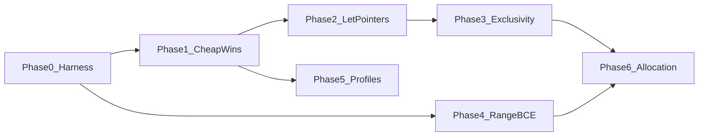

# Beryl v0.2 — native performance overhaul

Status: **approved, implementation started 2026-09-12.** Governs the
`v0.2-performance` branch. v0.1 is preserved as tag `v0.1` (commit `16c0e85`).

## Scope

| Question | Decision |
|---|---|
| Surfaces | Native runtime speed of generated C, and a trustworthy benchmark harness with C/Rust baselines. |
| Out of scope | Compiler wall-clock, EnforceScript output efficiency, SoA layouts, PGO, search, user generics. |
| Depth | Full: complete exclusivity so aliasing guarantees can be emitted, range analysis for check elimination, allocation model, plus flags and codegen fixes. |
| Determinism | An opt-in `[profile.native]` may relax FP contraction and select a target CPU. The default profile stays bit-identical with Enfusion. |

This plan supersedes exactly one sentence of
[BERYL_ADVANCED_IMPLEMENTATION_PLAN.md](BERYL_ADVANCED_IMPLEMENTATION_PLAN.md)
Stage J: "Global `restrict` stays disabled." Under this plan `restrict` becomes
emittable after the Phase 3 exit gate, per function, only where the analysis
admits it. Every other rule in that document's §4.3 measurement protocol, §4.4
optimization lifecycle and §4.5 promotion rules continues to apply unchanged.

## Verified starting point (2026-09-12)

- Toolchain: clang 22.1.6 `x86_64-w64-windows-gnu`, Python 3.13.13, rustc 1.96.0.
- Compiler builds clean under `-std=c11 -Wall -Wextra -Werror` at `-O2` from 56
  translation units. Unit baseline: **501 cases, 10,304 checks, exit 0**.
- No valid performance numbers exist. [BENCHMARKS.md](BENCHMARKS.md) retracts
  every figure; `scripts/bench.sh` has an overflowing checked workload, ignores
  exit status, and builds a fixture with no `main`.
  `tools/beryl-experiments/evaluate.py` is a receipt-only statistical gate;
  `collect.py` ingests Enfusion timings and never runs a native binary. There are
  no `.rs` files and no `tests/perf/` in the repository.

### Where the cycles are, by inspection

1. **No aliasing information reaches LLVM.** `fn_signature`
   (`src/back/c_backend.c:1304`) emits plain `T *` for `inout`/`set`; `restrict`
   appears only in the C keyword list (`:39`). Rust gets `noalias` on every
   `&mut`. This blocks reordering, load hoisting and vectorization in hot loops.
2. **Read-only aggregates are copied per call.** `call_arg` (`:667`) materializes
   every `let` argument into a temp and passes it by value, including `[T; N]`
   (a struct wrapping `v[N]`, `:218`) and structs. `for x in array` copies the
   whole array first (`:1213`).
3. **Bounds checks are never eliminated.** Every index, `get` and `set` calls
   `be_idx` (`runtime/beryl_rt.h:101`, `c_backend.c:249`, `:854`). Range facts
   exist only inside `src/sema/taint.c` (`TRange`, `range_of:129`), are
   recomputed per query, are never stored on the AST, and feed exactly one
   diagnostic waiver (`check_index_sink:324`).
4. **Trap paths are not marked cold.** Traps are `_Noreturn` but carry no
   `cold` attribute and no `__builtin_expect` on the guard branches.
5. **Conservative build.** `src/driver/build.c:260` uses `-O2`/`-O0`,
   `-ffp-contract=off`, `-fno-fast-math`, no LTO, no `-march`, and two
   translation units (generated C plus `beryl_rt.c`), so runtime helpers never
   inline into generated code. `beryl.toml` has no profile concept
   (`src/driver/manifest.c:93`).
6. **Allocation.** `List<T>` is a lone `realloc`-doubling buffer; `clear` keeps
   capacity; there is no `reserve`, no scope-exit release, and no pools.
   `Pool<T>`/`Handle<T>` are reserved for v0.2 by `SPEC.md` §3 (`BE0902`).

### Exclusivity: what is already true

Verified in `src/sema/ownership.c` `check_call_exclusivity:248`:

- Pairwise overlap of local access paths, entry count unbounded (the "17 entry
  cap" in the Codex handoff no longer exists), field depth 6 collapsing
  **conservatively** to a whole-root conflict, any index treated as whole-root.
- Covers two `inout` to one root, `inout` versus `let`, and `inout self`
  receivers. Six `test_exclusivity` cases already assert this.
- Language has no mutable module-level state (`ast.h:302` has no mutable item
  kind), and borrows are second-class, so a callee reaches caller storage only
  through parameters.
- `storage_admit` (`src/sema/storage.c:307`) runs inside `native_lint`
  (`c_backend.c:1399`) and rejects general owning copies.

Gaps that must close before `restrict`:

- Intrinsic `List` mutator receivers are not in the pairwise set (`:255`, `:395`).
- Arguments whose place is not a local path are silently dropped (`valid=false`).
- Cross-binding storage identity is not proved; `ty_is_copy`
  (`src/sema/types.c:196`) has zero callers.

## Phase map

## Phase 0 — Measurement harness

New `tools/beryl-bench/`. Emits receipts in the `beryl.performance.*` v1 schema
that `tools/beryl-experiments/evaluate.py` already validates, so no new
statistics code is written.

1. `run.py`: per workload, build the Beryl candidate and every baseline with
   recorded argv; validate stdout **and** exit status of each binary against a
   golden file; then time at least 30 paired blocks in balanced A/B order.
   Writes `pilot.json` (baseline versus baseline, for noise) and `blocks.json`
   (baseline versus candidate). Any semantic mismatch or non-zero exit aborts the
   run. Records revision, toolchain versions and hashes, OS/CPU, flags,
   repetitions and peak RSS.
2. Workloads under `tools/beryl-bench/workloads/<name>/`, each with `main.be`,
   `baseline.c`, `baseline.rs`, `expected.txt`, `workload.json`. Each later phase
   owns one:
   - `checked_lcg` — non-overflowing checked i32 chain (Phase 1).
   - `struct_pass` — large aggregate passed `let` through a call chain (Phase 2).
   - `inout_axpy` — two `inout` arrays updated in one loop (Phase 3).
   - `array_sum_2d` — `[[i32; 64]; 64]` kernel indexed by `for i in 0..N` (Phase 4).
   - `vec3_particles` — f32 `Vec3` integration loop (Phase 5).
   - `list_grow_reuse` — push/clear/reuse cycles (Phase 6).
3. Rust baseline matrix per
   [BERYL_PERFORMANCE_RESEARCH_2026-09-07.md](BERYL_PERFORMANCE_RESEARCH_2026-09-07.md)
   §19, with profiles committed in `tools/beryl-bench/rust/Cargo.toml`:
   `idiomatic` (release defaults), `matched` (`overflow-checks = true`,
   `panic = "abort"`, same algorithm and layout), `tuned` (`lto = "fat"`,
   `codegen-units = 1`, `-C target-cpu=native`). The C baseline uses the same
   clang and flags as the Beryl candidate.
4. Delete `scripts/bench.sh`; rewrite `BENCHMARKS.md` to point at the harness and
   keep the historical section clearly labelled as retracted.

Exit gate: pilot noise characterized per workload; `evaluate.py` freeze accepted;
a deliberately wrong candidate is rejected by the runner. No claim is published.

## Phase 1 — Cheap, semantics-preserving wins

1. `runtime/beryl_rt.h`: `__attribute__((cold))` on the four traps and
   `beryl_allocation_size_failure`; `__builtin_expect(..., 0)` on every overflow,
   bounds and divide-by-zero guard. Regenerate `src/back/runtime_embed.h`.
2. `be_str_eq`: `memcmp` after the length check instead of a byte loop.
3. `for x in array` (`c_backend.c:1211`): iterate the place directly when the
   iterable is a place; keep the temp for computed iterables.
4. Vector helpers: clang `ext_vector_type` under `#ifdef __clang__`, retaining
   the scalar fallback and the existing union layout so `.x` / `.v[i]` and
   Enfusion parity are unchanged.
5. Single translation unit: generated C includes `beryl_rt.c` from the job
   directory so runtime helpers inline without LTO. `beryl_rt.c` stays
   separately compilable for the test harness.

Exit gate: unit suite (currently 501/10,304) and every e2e program pass at O0 and
O2 and under UBSan; generated-C determinism unchanged; no regression beyond the
§4.3 threshold on any workload.

## Phase 2 — Pass `let` aggregates by `const T *`

Semantics unchanged; only the C ABI for read-only aggregate parameters.

1. Wire `ty_is_copy` into codegen. A `let` parameter that is not a copy type, or
   is larger than two machine words, becomes `const T *` in `fn_signature`, with
   its address taken in `call_arg` and body reads dereferenced. `str` stays by
   value.
2. Defaults expanded at the call site and `let self` receivers follow the same
   rule.
3. A `let` argument whose place is not a local path is still passed by value,
   never by pointer.
4. `sink` stays by value; ownership already kills the caller binding.

Exit gate: `struct_pass` improves at threshold; suite green at O0/O2/UBSan; new
tests assert `let`-versus-`inout` overlap is still `BE0401` through receivers,
defaults and nested calls; Enfusion output byte-identical.

## Phase 3 — Complete exclusivity, then emit `restrict`

1. Intrinsic receivers join the pairwise set: `List.push/set/clear` as
   `CONV_INOUT`, `get/len` as `CONV_LET`. Mirror the six existing
   `test_exclusivity` cases for intrinsics.
2. Fail closed: an exclusive argument whose path is unproven marks the enclosing
   function `restrict_admitted = false` with a recorded blocker span, instead of
   silently skipping the overlap check.
3. Prove storage identity as a tested invariant: within the native admitted
   subset no two live locals may alias one heap buffer. Cover owning copy, `let x
   = ys` for `List`, struct-containing-list copy, and `sink` transfer. Replace the
   "omits `restrict`" paragraph in `SPEC.md` §4.4 with the proved invariant.
4. Emit `T *restrict` for `inout`/`set` and `const T *restrict` for pointer-`let`
   when `restrict_admitted`, with a comment naming the licensing invariant.
5. Differential defense: reference and IR evaluators ignore `restrict`; run every
   e2e and PID fixture at O0, O2 and O3 and compare. Divergence indicates a
   soundness bug in steps 1-3, not a codegen bug.

Exit gate: `inout_axpy` shows packed operations in `-S` output and improves at
threshold; O0/O2/O3 outputs identical across all fixtures; `BE0401` count on the
existing corpus does not increase.

## Phase 4 — Range analysis and bounds-check elimination

1. New `src/sema/range.c/.h`: forward interval analysis per function, storing
   `Interval {bool known; int64_t lo, hi;}` on `Local` and on index `Expr`s.
   Fact sources: integer literals, `const`, immutable `let` inits,
   `for i in lo..hi`, `clamp`/`min`/`max`, `%` by a positive constant, `if`
   guards of the form `i >= 0 && i < n`, and `xs.len()` where `xs` is not
   mutated in the loop (reuse `storage.c` `stable_expr`).
2. `taint.c` `range_of` becomes a thin call into the shared pass; the BE0601
   waiver behaviour is unchanged and its regressions still pass.
3. Index emission omits `be_idx` when the fact proves `0 <= lo` and
   `hi < array_len` (fixed arrays) or `hi < hoisted_len` (stable lists). Trace
   mode always keeps the check so expected-trap fixtures remain valid.
4. IR carries the same fact so the IR evaluator can assert the proof in debug.

Exit gate: `array_sum_2d` inner loop contains no `be_idx` call in `-S` output and
improves at threshold; every `tests/reference/expected_traps/*` still traps at the
same site; a generated-shape test confirms the reference evaluator never traps
where a check was removed.

## Phase 5 — Build profiles

1. `[profile.native]` in `beryl.toml` (new section bit in
   `src/driver/manifest.c:93`, fields on `Manifest`): `opt`, `lto`, `target_cpu`,
   `fp_contract`, `fast_math`. Defaults reproduce today's flags exactly.
2. `BuildOpts` carries the profile; `build.c` translates it to clang argv and
   records it in `compile.argv.json` and the native evidence.
3. `beryl build` refuses `fp_contract = "fast"` or `fast_math = true` when the
   package also declares `[target.enfusion]`, with a new documented `BE08xx`
   diagnostic explaining the determinism contract.
4. `beryl test` always uses the deterministic profile.

Exit gate: default profile yields byte-identical generated C and identical clang
argv to v0.1; `vec3_particles` measured separately under the relaxed profile
against the `tuned` Rust row.

## Phase 6 — Allocation model

1. `List<T>.reserve(n)` and `with_capacity(n)` across checker, both emitters and
   the reference evaluator.
2. Scope-exit release for owned locals in the admitted subset: emit
   `beryl_release` at block exit, early `return`, `break`, `continue` and `try`
   propagation, in reverse declaration order. This closes BR-02 and BR-08 and
   moves `defer` to true scope-exit semantics, which is a documented SPEC change.
   Gate with ASan and LSan runs of the e2e suite.
3. `Pool<T>` and `Handle<T>`: slab-allocated, generation-checked, one
   `be_pool_at` helper for the bounds-and-generation check.

Exit gate: `list_grow_reuse` improves at threshold with zero leaks under LSan; no
allocation-count regression on the PID fixtures.

## Verification rules for every phase

- Unit suite normal and UBSan; e2e at O0 and O2; `check-diagnostics.sh` (its
  three-digit regex must be fixed first — it currently checks BE1001 as BE0100).
- Reference and IR differential fixtures unchanged unless a phase says otherwise.
- Paired measurement per advanced-plan §4.3: at least 30 blocks, balanced order,
  threshold `max(5%, pilot p95)`, held-out workload after tuning. Never multiply
  overlapping speedups; each phase is compared against the previous phase's
  verified candidate, not against v0.1.
- Each phase lands as its own commit series on `v0.2-performance` with a receipt
  under `build/` and an entry in this document's progress log.

## Progress log

| Phase | State | Evidence |
|---|---|---|
| Backup | Done | tag `v0.1` at `16c0e85`; baseline 501 cases / 10,304 checks, clean `-Werror` O2 build |
| 0 Harness | In progress | — |
| 1 Cheap wins | Not started | — |
| 2 Let pointers | Not started | — |
| 3 Exclusivity | Not started | — |
| 4 Range/BCE | Not started | — |
| 5 Profiles | Not started | — |
| 6 Allocation | Not started | — |
