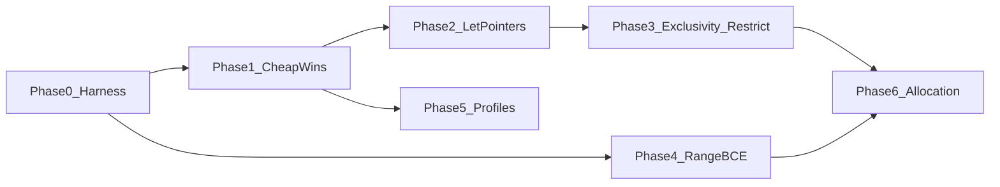

# Beryl v0.2 — native performance overhaul plan

Status: **in progress, 2026-09-12.** Governs v0.2 performance work. The v0.1
tag is still pending (shell hook blocked `git` in the session that started this
branch); take the snapshot before merging anything.

Already present in the v0.1 working tree, so Phase 1 items 1–2 are **done**:
`BE_COLD` / `BE_UNLIKELY` and `be_str_eq` → `memcmp` in `runtime/beryl_rt.h`.

Scope decisions recorded from the owner:

| Question | Decision |
|---|---|
| Surfaces | Native runtime speed of generated C, and a trustworthy benchmark harness with C/Rust baselines. Compiler wall-clock and EnforceScript output efficiency are out of scope. |
| Depth | Full: finish exclusivity so aliasing guarantees can be emitted, add range analysis for check elimination, pools/arenas, plus flags and codegen fixes. |
| Determinism | A native-only `[profile.native]` may opt in to FP contraction and target-CPU flags. The default profile stays bit-identical with Enfusion. |

This plan supersedes one sentence of the advanced plan's Stage J ("Global
`restrict` stays disabled"): `restrict` becomes emittable **only after Phase 3's
exit gate**, and only for functions the analysis admits. Every other rule in
[BERYL_ADVANCED_IMPLEMENTATION_PLAN.md](BERYL_ADVANCED_IMPLEMENTATION_PLAN.md)
§4.3–4.5 (measurement protocol, optimization lifecycle, promotion) still applies.

## 0. Baseline facts this plan is built on

Established by source inspection on 2026-09-11; each phase re-verifies its own.

- No valid performance numbers exist. `docs/BENCHMARKS.md` retracts every figure.
  `scripts/bench.sh` now exits 2 and points at `tools/beryl-bench/run.py`.
  `tools/beryl-experiments/evaluate.py` is a receipt-only statistical gate;
  `collect.py` ingests Enfusion timings and never runs a native binary. Rust
  baseline sources live under `tools/beryl-bench/rust/`; this collector
  revision times the C diagnostic baseline only.
- Calling convention (`src/back/c_backend.c` `call_arg` ~667, `fn_signature` ~1304):
  `inout`/`set` are plain `T *` (no `restrict`); `let` and `sink` are materialized
  into a temp and passed **by value**, including `[T; N]` (a struct wrapping `v[N]`)
  and structs. `for x in array` copies the whole array into a temp first (~1213).
- Bounds checks: every `xs[i]`, `get`, `set` calls `be_idx` (`runtime/beryl_rt.h:101`,
  `c_backend.c` ~249–259, ~854–868). No elimination exists. Range facts live only
  inside `src/sema/taint.c` (`TRange`, `range_of` ~129–214), are recomputed per
  query, are never stored on the AST, and are consumed by exactly one waiver
  (`check_index_sink` ~324).
- Exclusivity (`src/sema/ownership.c` `check_call_exclusivity` ~248–294): pairwise
  local-path check, unbounded entry count, field depth 6 collapsing conservatively
  to a root conflict, any index treated as whole-root. Gaps: intrinsic list mutator
  receivers are not in the pairwise set (~255–257, ~395–401); non-local places are
  silently dropped (`valid=false`); `ty_is_copy` (`types.c:196`) has zero callers.
- `storage_admit` (`src/sema/storage.c:307`) runs inside `native_lint`
  (`c_backend.c:1399`) and rejects general owning copies, so within the admitted
  subset two `List` locals cannot share a backing buffer. This must be turned into
  a tested invariant before it is relied upon.
- Traps are `_Noreturn` and `cold`; overflow, bounds, and divide-by-zero branches use `__builtin_expect`. `be_str_eq` is `memcmp`.
- Build (`src/driver/build.c` ~260–267): `-O2` or `-O0`, `-ffp-contract=off`,
  `-fno-fast-math`, no LTO, no `-march`, two translation units (generated C plus
  `beryl_rt.c`). `beryl.toml` has no profile concept (`manifest.c` ~93–140).
- `List<T>`: lone `realloc`-doubling buffer, `clear` keeps capacity (`len = 0`),
  no `reserve`, no scope-exit release, no pools. `Pool<T>`/`Handle<T>` are reserved
  for v0.2 by `SPEC.md` §3 (`BE0902`).

## 1. Phase map

Phases 0 and 1 are independent of each other but every later phase requires
Phase 0, because no optimization is promoted without a paired measurement.

## 2. Phase 0 — Measurement harness (`tools/beryl-bench/`)

Goal: a native runner that produces receipts `evaluate.py` already accepts
(`beryl.performance.*` schema v1), so no new statistics code is written.

Deliverables:

1. `tools/beryl-bench/run.py` — for each workload: build Beryl (`beryl build
   --release`), build baselines with recorded argv, validate **output and exit
   status** of every binary against a golden, then time ≥30 paired blocks in
   balanced A/B order, writing `pilot.json` (baseline vs baseline) and
   `blocks.json` (baseline vs candidate). Reject and stop on any semantic
   mismatch or non-zero exit. Record revision, toolchain hashes (`clang
   --version`, `rustc -Vv`), OS/CPU, flags, repetitions, and peak RSS.
2. `tools/beryl-bench/workloads/<name>/` each containing `main.be`,
   `baseline.c`, `baseline.rs`, `expected.txt`, and `workload.json`
   (metric, paid components, resource budget). Initial set, chosen so each
   later phase has a workload that isolates its effect:
   - `checked_lcg` — non-overflowing checked i32 chain (Phase 1 cold paths).
   - `array_sum_2d` — fixed `[[i32; 64]; 64]` kernel with `for i in 0..N`
     indexing (Phase 4 BCE).
   - `struct_pass` — large struct/array passed `let` through a call chain
     (Phase 2 pointer passing).
   - `inout_axpy` — two `inout` arrays updated in one loop (Phase 3 `restrict`).
   - `list_grow_reuse` — push/clear/reuse cycles (Phase 6 allocation).
   - `vec3_particles` — f32 `Vec3` integration loop (Phase 5 profile flags).
3. Rust baseline matrix per `BERYL_PERFORMANCE_RESEARCH_2026-09-07.md` §19, with
   explicit Cargo profiles committed in `tools/beryl-bench/rust/Cargo.toml`:
   `idiomatic` (release defaults), `matched` (`overflow-checks = true`,
   `panic = "abort"`, same algorithm/layout), `tuned` (`lto = "fat"`,
   `codegen-units = 1`, `-C target-cpu=native`). C diagnostic baseline built with
   the same clang and flags as the Beryl candidate.
4. `scripts/bench.sh` is a stub that exits 2. `docs/BENCHMARKS.md` points at this
   collector. Historical tables stay labelled as retracted.

Landed in tree: `tools/beryl-bench/` (collector, six workloads, Rust sources,
receipt helpers, unit tests). A live `collect` run still needs a built
`build/beryl.exe` and a working shell.

Exit gate: pilot noise characterized for every workload; `evaluate.py freeze`
succeeds; a deliberately broken candidate (wrong output) is rejected by the
runner. No performance claim is made in this phase.

## 3. Phase 1 — Cheap, semantics-preserving codegen and runtime wins

All changes here are observable only through timing and machine code.

1. `runtime/beryl_rt.h`: add `__attribute__((cold))` to the four trap functions
   and `beryl_allocation_size_failure`; wrap every overflow/bounds/div-zero test in
   `__builtin_expect(..., 0)`. Regenerate `src/back/runtime_embed.h` with
   `scripts/embed_runtime.py`.
2. `be_str_eq`: call `memcmp` after the length check.
3. `for x in array` (`c_backend.c`): an immutable place is iterated through a
   `const T *`. Mutable bindings and non-places still copy the array.
4. Vector helpers evaluate lanes with clang `ext_vector_type(4)` temporaries.
   The stored `BeVec*` union layout is unchanged. Other compilers keep the
   scalar loops.
5. Generated C `#include`s `beryl_rt.c`, and the AST native link no longer
   compiles that file a second time. IR emission still compiles it separately.

Items 1–5 are in the working tree. Checked on 2026-09-26 with Clang 22.1.6:
unit suite 501 cases / 10,304 checks; `structs`, `vectors`, `lists`, and `arith`
match their goldens at O0 and O2. A mutable `for v in a` still copies the array;
an immutable one iterates through `const T *`. The full UBSan suite and the
paired `checked_lcg` / `vec3_particles` timings are not recorded yet.

Exit gate: 496+ unit cases and all e2e programs pass at O0/O2 and under UBSan;
generated-C determinism checks unchanged; `checked_lcg` and `vec3_particles`
show improvement or no regression at the §4.3 threshold (either outcome is
acceptable here; regressions are not). The UBSan and timing halves of this gate
are still open.

## 4. Phase 2 — Pass `let` aggregates by `const T *`

Semantics do not change; only the C ABI for read-only aggregate parameters.

1. `let` parameters whose type is not `ty_is_copy` are `const T *`. `str` stays a
   slice. `sink` stays by value. A call with a local place passes its address. A
   non-place is copied into a temporary and the pointer aims at that temporary,
   so the callee ABI does not depend on the call site.
2. `let self` and call-site defaults use the same rule. `len`/`get` take
   `const List *`, so a field of a `let` receiver does not drop const.
3. New ownership tests: a `let` method receiver or `let` aggregate overlapping
   `inout` of the same value is `BE0401`; a call result and a default aggregate
   do not alias that `inout`.

Checked on 2026-09-26: unit suite 505 cases / 10,310 checks before the const-list
pointer fix; `structs` matches its golden; `struct_pass` prints `992`; `lists`
generated C compiles with `-Werror` aside from a pre-existing unused loop
variable. The paired timing gate and the full UBSan run are still open.

Exit gate: `struct_pass` improves at threshold; full suite green at O0/O2/UBSan;
new ownership tests for `let`-vs-`inout` overlap through receivers/defaults pass;
`enforce` output byte-identical (this phase touches only the C emitter). The
timing, UBSan, and Enforce byte-compare halves of this gate are still open.

## 5. Phase 3 — Complete exclusivity, then emit `restrict`

The single largest lever, and the only one Rust gets for free (`noalias` on
`&mut`). Ordered so that each step is independently testable.

1. **Intrinsic receivers join the pairwise set.** `List.push`/`set`/`clear`
   receivers are exclusive accesses. `get`/`len` receivers are shared, including
   when the call is an argument (`xs.set(i, xs.get(0))`, `f(inout xs, xs.len())`).
2. **Fail closed.** An exclusive argument that is not a proven local path clears
   `Item.restrict_admitted` and records `restrict_blocker`. The type checker
   already rejects `inout` of a non-local, so this is the backstop.
3. **Storage identity** stays the native admission gate in `storage_admit`.
   Existing tests reject a second live `List` owner, a struct that contains one,
   and a `sink` transfer of a list. `SPEC.md` §4.4 now states the `restrict` rule.
4. **Emit `restrict`.** Admitted `inout`/`set` parameters are `T *restrict`.
   Admitted pointer-`let` parameters are `const T *restrict`.

Checked on 2026-09-26: unit suite 510 cases / 10,317 checks. `inout_axpy` prints
`5120000`. Its `add` parameters are `*restrict`, and the `-O2` loop is a 2-wide
scalar overflow check with no per-iteration bounds call. Packed integer adds do
not appear: the overflow branch is still in the loop. `structs` still matches
its golden.

Exit gate: `inout_axpy` vectorizes (inspect `-S` output for packed ops) and
improves at threshold; O0/O2/O3 outputs identical across all e2e and PID
comparison fixtures; `BE0401` false-positive rate on the existing corpus does not
increase (count diagnostics before/after on `tests/` and `packages/`). Packed
adds, the paired timing, and the full O0/O2/O3 differential are still open.

## 6. Phase 4 — Range analysis and bounds-check elimination

Replaces the private `TRange` in `taint.c` with a shared pass.

1. New `src/sema/range.c/.h`: forward interval analysis per function producing
   `Interval {bool known; int64_t lo, hi;}` **stored on `Local`** (new fields) and
   on `Expr` for index expressions (new `Expr.range_fact`). Sources of facts:
   integer literals, `const`, immutable `let` inits, `for i in lo..hi` (loop var
   is `[lo, hi-1]` when both bounds are known or `hi` is an array length),
   `clamp/min/max`, `%` by a positive constant, `if` guards of the form
   `i < n && i >= 0` narrowing the guarded branch, and `xs.len()` for `List` only
   when `xs` is not mutated in the loop (reuse `storage.c` `stable_expr`).
2. `taint.c` `range_of` becomes a thin call into `range.c`; behaviour of the
   BE0601 waiver unchanged (regression tests already exist).
3. `c_backend.c` index emission: when the index fact satisfies
   `0 <= lo && hi < array_len` (fixed arrays) or `hi < hoisted_len` (stable
   lists), emit the raw access. Otherwise `be_idx` as today. Trace mode
   (`CGEN_TRACE_TESTS`) always keeps the check so expected-trap fixtures stay valid.
4. IR (`src/ir/ir.c`) gains the same fact via `IR_INDEX` metadata so the IR
   evaluator can assert the proof (trap if the proof is wrong in debug builds).

Exit gate: `array_sum_2d` inner loop has no `be_idx` call in `-S` output and
improves at threshold; all `tests/reference/expected_traps/*` still trap at the
same sites; a fuzz-style unit test generates random `for`/`if`/index shapes and
checks the reference evaluator never traps where codegen removed a check.

## 7. Phase 5 — Build profiles

1. `beryl.toml` gains `[profile.native]` (new section bit in `manifest.c` ~100,
   fields on `Manifest`): `opt = "2" | "3"`, `lto = true|false`,
   `target_cpu = "native" | "<name>"`, `fp_contract = "off" | "fast"`,
   `fast_math = false|true`. Defaults reproduce today's flags exactly.
2. `BuildOpts` (`src/driver/build.h`) carries the profile; `build.c` translates to
   clang argv and records the profile in `compile.argv.json` and native evidence.
3. `beryl build` refuses `fp_contract = "fast"` or `fast_math = true` when the
   package also declares `[target.enfusion]`, with a diagnostic (new `BE08xx`
   code, documented in `DIAGNOSTICS.md`) explaining the determinism contract.
4. `beryl test` always uses the deterministic profile so differential fixtures
   are unaffected.

Exit gate: default profile produces byte-identical generated C and identical
clang argv to v0.1; `vec3_particles` under `opt=3, target_cpu=native,
fp_contract=fast` measured separately against the `tuned` Rust row.

## 8. Phase 6 — Allocation model

Depends on Phases 3 and 4 because pools need exclusivity and bounded indices.

1. `List<T>.reserve(n)` and `List<T>.with_capacity(n)` intrinsics (checker,
   both emitters, reference evaluator; Enfusion maps to `array.Reserve`).
2. Scope-exit release for owned locals in the admitted subset: emit
   `beryl_release` at block exit, early `return`, `break`, `continue`, and `try`
   propagation, in reverse declaration order. This is BR-02/BR-08 and moves
   `defer` to true scope-exit semantics at the same time (SPEC change, documented).
   Gate with ASan/LSan runs of the e2e suite.
3. `Pool<T>` and `Handle<T>` (SPEC v0.2): slab-allocated, generation-checked,
   `handle.get()` bounds+generation checked via one `be_pool_at` helper; SoA is
   **not** attempted in v0.2.

Exit gate: `list_grow_reuse` improves at threshold with zero leaks under LSan;
no allocation-count regression on the PID comparison fixtures.

## 9. Verification rules for every phase

- Unit (`scripts/test.sh`) normal and UBSan; e2e at O0 and O2 (`scripts/e2e.sh`);
  `scripts/check-diagnostics.sh` (fix its 3-digit regex first, see review).
- Reference and IR differential fixtures unchanged unless the phase says otherwise.
- Paired measurement per §4.3 of the advanced plan: ≥30 blocks, balanced order,
  threshold `max(5%, pilot p95)`, held-out workload after tuning. Never multiply
  overlapping speedups; compare each phase against the previous phase's verified
  candidate.
- Each phase lands as its own commit series on `v0.2-performance` with a receipt
  under `build/` and a one-paragraph entry in `docs/BERYL_DELIVERY_STATE.md`.

## 10. Explicitly deferred

Compile-time (runtime object cache, incremental), EnforceScript output
efficiency, SoA layouts, PGO and equality-saturation search (Stage K), user
generics. Each is out of scope for v0.2 by the owner's decision or because it
depends on generics.
